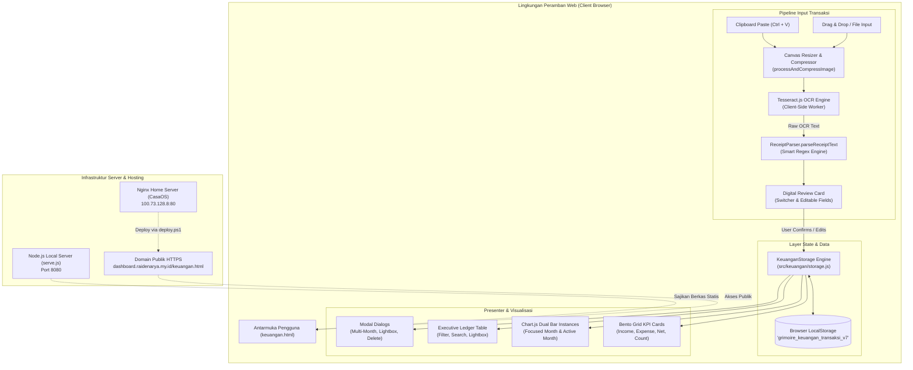
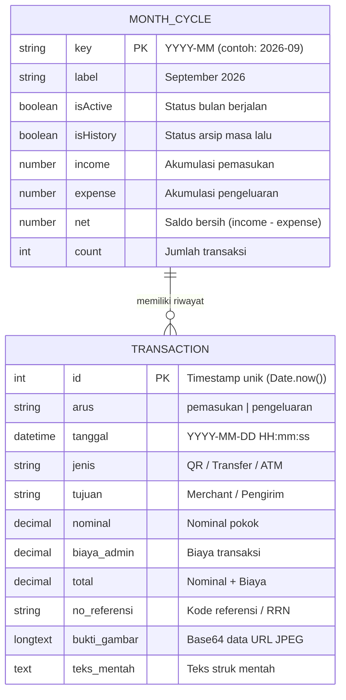

# ARCNUM FINANCE (ARCANUM FINANCE) • CONTEXT & ARCHITECTURAL SPECIFICATION

Dokumen ini adalah **konteks teknis lengkap** dari modul aplikasi web **Arcanum Finance** (disebut juga **Arcnum Finance** atau **Money Tracker**) di dalam repositori **Arz-WEB**. Dokumen ini dirancang khusus agar asisten AI teknis (seperti Claude) dan perekayasa perangkat lunak dapat langsung memahami arsitektur, alur data, logika bisnis, antarmuka, dan infrastruktur sistem secara mendalam tanpa perlu membaca kode sumber berkas per berkas.

---

## 1. Ringkasan Proyek

**Arcanum Finance** (berkas utama: [keuangan.html](file:///c:/Users/Raden/OneDrive/Documents/New%20folder%20(2)/keuangan.html)) adalah aplikasi web pencatatan keuangan personal (*personal cashflow tracker*) mandiri yang mengusung prinsip **Keuangan Murni (*Pure Finance*)** dan **Nol Friksi Input (*Zero Friction*)**. Sistem ini menghilangkan hierarki kategori pembukuan konvensional yang rumit dan berfokus penuh pada aliran dana masuk dan keluar (**Dual-Stream Cashflow**: *Inflow* `+` dan *Outflow* `-`). Desain visualnya mengadopsi arsitektur *Cyber-Arcane & Technical Dense FinTech Cockpit* berbasis Glassmorphism, Bento Grid, dan standar ergonomi *Android-Fit Protocol*.

Aplikasi ini ditujukan bagi pengguna personal (mahasiswa, developer, maupun profesional eksekutif) yang memerlukan pencatatan mutasi rekening dan struk transaksi harian secara instan, akurat, dan otomatis. Fitur unggulan aplikasi meliputi: pemindaian bukti transaksi digital berbasis **AI OCR Vision (Tesseract.js)** di sisi peramban (*client-side*), mesin ekstraksi teks cerdas (**Smart Regex Parser**) multi-kanal (m-Transfer BCA, struk QRIS, tarikan ATM tunai, BI FAST), kartu review transaksi interaktif dengan *inline contenteditable fields*, analitik visual dua kotak (*Dual-Box Monthly Bar Charts* via Chart.js), tabel konsolidasi multi-bulan, ledger riwayat transaksi dengan filter dan pencarian instan, modal lightbox gambar bukti resolusi tinggi, serta sistem pengarsipan otomatis siklus bulan (*Auto-Rollover History*).

---

## 2. Tech Stack

Berikut adalah rincian tumpukan teknologi (*technology stack*), pustaka, dan dependensi yang digunakan secara aktif oleh Arcanum Finance berdasarkan kode sumber dan file konfigurasi:

| Komponen / Lapisan | Teknologi / Pustaka | Versi / Sumber | Fungsi & Alasan Pemilihan | File Terkait |
| :--- | :--- | :--- | :--- | :--- |
| **Frontend Core** | HTML5 Semantic | Standar W3C | Struktur markup portal mandiri, meta viewport Android, dan elemen aksesibilitas WCAG. | [keuangan.html](file:///c:/Users/Raden/OneDrive/Documents/New%20folder%20(2)/keuangan.html) |
| **Styling & Design System** | Vanilla CSS3 (Custom Properties & Glassmorphism) | Modern CSS3 | Token warna Cyber-Arcane FinTech, Bento Grid, Concentric Radii Math, safe-area insets, dan adaptasi Android. | [src/keuangan/keuangan.css](file:///c:/Users/Raden/OneDrive/Documents/New%20folder%20(2)/src/keuangan/keuangan.css) |
| **Logic & Controller** | JavaScript (ES6+ Vanilla) | Browser Native (IIFE) | Logika kontrol UI, penanganan event clipboard/drag-drop, kompresi canvas, kalkulasi KPI, dan orkestrasi modal. | [src/keuangan/keuangan.js](file:///c:/Users/Raden/OneDrive/Documents/New%20folder%20(2)/src/keuangan/keuangan.js) |
| **Storage & State** | Web Storage API (`localStorage`) | Browser Native | Penyimpanan persistensi transaksi lokal client-side, manajemen multi-bulan, dan state offset simulasi. | [src/keuangan/storage.js](file:///c:/Users/Raden/OneDrive/Documents/New%20folder%20(2)/src/keuangan/storage.js) |
| **Regex Parser Engine** | Vanilla JavaScript Regex | Native ES6 | Parser ekspresi reguler deterministik untuk ekstraksi nominal uang, tanggal/waktu, jenis mutasi, dan nama merchant. | [src/keuangan/parser.js](file:///c:/Users/Raden/OneDrive/Documents/New%20folder%20(2)/src/keuangan/parser.js) |
| **Client-Side AI OCR** | Tesseract.js | v5 (via jsDelivr CDN) | Pustaka OCR pemrosesan citra ke teks lokal di thread peramban web tanpa membebani server backend. | CDN di [keuangan.html](file:///c:/Users/Raden/OneDrive/Documents/New%20folder%20(2)/keuangan.html#L27) |
| **Visual Charting** | Chart.js | Latest (via jsDelivr CDN) | Visualisasi grafik batang ganda (*dual bar chart*) komparasi pemasukan dan pengeluaran antar-siklus bulan. | CDN di [keuangan.html](file:///c:/Users/Raden/OneDrive/Documents/New%20folder%20(2)/keuangan.html#L24) |
| **Iconography** | FontAwesome Free | v6.4.0 (via cdnjs CDN) | Sistem ikon visual untuk status transaksi, tindakan tabel, tombol dropzone, dan indikator telemetri. | CDN di [keuangan.html](file:///c:/Users/Raden/OneDrive/Documents/New%20folder%20(2)/keuangan.html#L21) |
| **Typography** | Google Fonts | Web Fonts CDN | Tipografi: *Plus Jakarta Sans* (Body/UI), *Cinzel* (Brand/Header), *JetBrains Mono* (Angka/Nominal), *MedievalSharp*. | CDN di [keuangan.html](file:///c:/Users/Raden/OneDrive/Documents/New%20folder%20(2)/keuangan.html#L18) |
| **Audio Synthesizer** | Web Audio API | Browser Native | Sintesis efek audio nada lonceng (*magic chime*) feedback saat transaksi disimpan atau dipindai. | [src/shared/audio.js](file:///c:/Users/Raden/OneDrive/Documents/New%20folder%20(2)/src/shared/audio.js) |
| **Background FX** | HTML5 2D Canvas API | Browser Native | Animasi partikel melayang (*magic particles*) ambient emas dan hijau lumut di latar belakang. | [src/shared/particles.js](file:///c:/Users/Raden/OneDrive/Documents/New%20folder%20(2)/src/shared/particles.js) |
| **Blueprint Skema Database** | MySQL / MariaDB SQL | SQL DDL Script | Referensi arsitektur relasional tabel `keuangan_transaksi` jika aplikasi diekspansi ke backend SQL. | [src/keuangan/keuangan.sql](file:///c:/Users/Raden/OneDrive/Documents/New%20folder%20(2)/src/keuangan/keuangan.sql) |
| **Dev / Static HTTP Server**| Node.js Native HTTP | Node.js v18+/v20+ | Server static file hosting lokal port 8080 tanpa dependensi Express. | [serve.js](file:///c:/Users/Raden/OneDrive/Documents/New%20folder%20(2)/serve.js), [server.js](file:///c:/Users/Raden/OneDrive/Documents/New%20folder%20(2)/server.js) |
| **Testing Automation** | TestSprite / Playwright Python | Python 3 + Playwright | Skenario uji end-to-end otomatis (`TC008`, `TC009`) untuk validasi fungsionalitas transaksi dan saldo. | [testsprite_tests/](file:///c:/Users/Raden/OneDrive/Documents/New%20folder%20(2)/testsprite_tests) |
| **Deploy & Production** | PowerShell + Nginx + CasaOS | Windows PowerShell | Skrip otomatisasi sinkronisasi berkas web ke Nginx Home Server (`100.73.128.8`) dan GitHub. | [deploy.ps1](file:///c:/Users/Raden/OneDrive/Documents/New%20folder%20(2)/deploy.ps1) |

---

## 3. Struktur Folder

Berikut adalah visualisasi pohon direktori proyek yang berfokus pada modul Arcanum Finance serta modul pendukungnya di repositori:

```text
├── keuangan.html                           # [ENTRY POINT] Halaman tunggal utama aplikasi Arcanum Finance
├── index.html                              # Portal induk Grimoire Dashboard (berisi launcher ke keuangan.html)
├── package.json                            # Konfigurasi npm package dan script dev/start server
├── serve.js                                # HTTP server mandiri Node.js (melayani file static & routing)
├── server.js                               # Alias entrypoint pengarah ke serve.js
├── deploy.ps1                              # Skrip PowerShell deployment ke Nginx Home Server
├── docker-compose.yml                      # Konfigurasi container Docker CasaOS (backend runtime)
├── AGENTS.md                               # Aturan kerja agen AI & protokol deployment Android-Fit
├── Arz-WEB.md                              # Dokumentasi arsitektur resmi ekosistem web Arz-WEB
├── README.md                               # Dokumentasi ringkas portofolio GitHub
│
├── src/
│   ├── keuangan/                           # [MODUL UTAMA] Seluruh aset & logika inti Arcanum Finance
│   │   ├── assets/
│   │   │   └── bukti_tarik_tunai_atm.png   # Aset gambar acuan pengujian struk penarikan tunai ATM
│   │   ├── keuangan.css                    # Stylesheet FinTech Cockpit, Glassmorphism, Bento, dan responsivitas
│   │   ├── keuangan.js                     # Controller utama: event DOM, Tesseract OCR, Chart.js, modals
│   │   ├── parser.js                       # Mesin Smart Regex Parser: ekstraksi nominal, tanggal, merchant
│   │   ├── storage.js                      # Service persistensi LocalStorage, auto-rollover, simulasi bulan
│   │   └── keuangan.sql                    # Skema acuan database relasional MySQL/MariaDB
│   │
│   ├── shared/                             # Komponen & utilitas yang dipakai bersama di ekosistem
│   │   ├── audio.js                        # Sintesis Web Audio API (lonceng sihir / chime & ambient drone)
│   │   ├── particles.js                    # Mesin animasi partikel canvas latar belakang (#magicParticles)
│   │   ├── shared.css                      # Variabel global & utilitas styling ekosistem
│   │   └── utils.js                        # Utilitas umum pembantu
│   │
│   ├── proyek/
│   │   └── proyek.js                       # Registry katalog proyek dashboard (mendaftarkan shortcut keuangan.html)
│   │
│   └── tutup-buku/
│       ├── tutup-buku.css                  # UI tombol 'Tutup Buku Grimoire' (kembali ke cover)
│       └── tutup-buku.js                   # Interaktivitas penutupan buku Grimoire (Bukan fitur accounting)
│
└── testsprite_tests/                       # Framework pengujian otonom TestSprite (Eksklusif Localhost)
    ├── TC008_Add_an_income_transaction_and_see_it_reflected_in_history.py
    ├── TC009_Add_an_expense_transaction_and_see_the_balance_update.py
    └── testsprite-runner.js                # Test runner automasi sebelum deployment
```

### Penjelasan File dan Folder Penting
- **[keuangan.html](file:///c:/Users/Raden/OneDrive/Documents/New%20folder%20(2)/keuangan.html)**: Titik masuk tunggal (*Single Entry Point*) yang merangkum Bento Grid KPI, Visualisasi Grafik Arus Kas, Kamar Pemindai Struk (*Receipt Scanner Chamber*), Kartu Tinjauan Digital (*Review Card*), Tabel Ledger Riwayat, dan 3 Modal Dialog.
- **[src/keuangan/parser.js](file:///c:/Users/Raden/OneDrive/Documents/New%20folder%20(2)/src/keuangan/parser.js)**: Mesin parser deterministik murni (*zero DOM dependency*). Menguraikan teks OCR mentah menjadi struktur transaksi terstandarisasi.
- **[src/keuangan/storage.js](file:///c:/Users/Raden/OneDrive/Documents/New%20folder%20(2)/src/keuangan/storage.js)**: Abstraksi layer data. Bertanggung jawab terhadap penyimpanan ke `localStorage`, agregasi total per bulan, identifikasi siklus aktif, dan rollover pergantian bulan.
- **[src/keuangan/keuangan.js](file:///c:/Users/Raden/OneDrive/Documents/New%20folder%20(2)/src/keuangan/keuangan.js)**: Menghubungkan parser, storage, dan view. Mengelola siklus OCR Tesseract.js, kanvas kompresi, rendering instans Chart.js, filter tabel, pencarian, dan interaksi keyboard modal.
- **[src/keuangan/keuangan.css](file:///c:/Users/Raden/OneDrive/Documents/New%20folder%20(2)/src/keuangan/keuangan.css)**: Berkas CSS komprehensif (~3000 baris) yang menerapkan variabel warna token finansial, glassmorphism gelap, skeleton shimmer, dan optimasi sentuhan mobile (min 44px–48px).

---

## 4. Arsitektur & Alur Sistem

### Arsitektur Keseluruhan
Arcanum Finance dirancang dengan pola **Client-Side Heavy Architecture** (JAMstack murni). Pemrosesan komputasi berat (AI OCR, manipulasi gambar canvas, agregasi statistik, kalkulasi cashflow) seluruhnya didelegasikan ke peramban pengguna (*Edge Client*). Server Node.js ([serve.js](file:///c:/Users/Raden/OneDrive/Documents/New%20folder%20(2)/serve.js)) atau server produksi Nginx murni bertindak sebagai penyaji statis (*Static File Web Server*) yang menyalurkan HTML, CSS, JavaScript, dan berkas aset visual.



### Alur Request & Siklus Data Transaksi
1. **Pemicu Pengguna**: Pengguna menempelkan gambar tangkapan layar bukti transfer melalui `Ctrl + V` atau mengunggah file lewat tombol *Browse* / *Drag-and-Drop*.
2. **Kompresi Citra**: Fungsi `processAndCompressImage(file, callback)` mereduksi dimensi gambar ke resolusi maksimal 1000px dengan rasio aspek terjaga menggunakan canvas HTML5, lalu mengekspornya menjadi format Base64 JPEG (kualitas 0.88).
3. **Eksekusi OCR**: `Tesseract.recognize()` dijalankan secara lokal dengan bahasa `'eng'`. Indikator progress bar live di `#ocrProgressBar` bergerak dari 10% hingga 100%.
4. **Parsing Teks Deterministik**: Teks hasil OCR diteruskan ke `ReceiptParser.parseReceiptText(ocrText)`. Parser mengekstrak nominal bersih, tanggal, jenis transaksi, nomor referensi, serta nama merchant.
5. **Peninjauan Interaktif (*Review Card*)**: Data yang terekstraksi ditampilkan pada `#parsedReviewCard`. Pengguna dapat mengganti arus (*Pemasukan* / *Pengeluaran*) melalui toggle, serta mengedit nama merchant atau waktu transaksi langsung pada elemen berstatus `contenteditable="true"`.
6. **Penyimpanan Transaksi**: Saat tombol `#btnSaveParsedTx` ditekan:
   - Nilai editan akhir diambil.
   - `KeuanganStorage.addTransaction(currentParsedData)` dipanggil.
   - Objek baru disisipkan ke indeks awal array transaksi (`unshift`).
   - Data diserialisasi menjadi JSON dan disimpan ke kunci `localStorage` (`grimoire_keuangan_transaksi_v7`).
   - Efek suara lonceng sihir dimainkan via `playMagicChime()`.
7. **Pembaruan Reaktif Tampilan**:
   - Fungsi `renderDashboard()` dieksekusi secara otomatis.
   - 4 kartu KPI menghitung ulang saldo konsolidasi bulan terkait.
   - Dua grafik batang Chart.js dihancurkan (`destroy()`) dan dirender ulang dengan nilai terkini.
   - Tabel transaksi memfilter ulang dan menampilkan baris transaksi baru di urutan teratas.

---

## 5. Database & Model Data

### 1. Struktur Model Data di LocalStorage
Persistensi aktif saat runtime web berjalan di peramban menggunakan `localStorage` dengan kunci utama:
- **`grimoire_keuangan_transaksi_v7`**: Berisi JSON array of transaction objects.
- **`grimoire_current_active_month_v1`**: Kunci string penyimpan bulan aktif sistem (format `YYYY-MM`).
- **`grimoire_simulated_month_offset_v1`**: Offset integer simulasi pergantian bulan untuk pengujian.

Struktur setiap objek transaksi dalam array:

| Properti | Tipe Data | Wajib / Opsional | Keterangan & Contoh Nilai |
| :--- | :--- | :--- | :--- |
| `id` | `Number` | Wajib | Unix Timestamp saat dibuat (contoh: `1726210000000`). Digunakan sebagai *unique identifier*. |
| `arus` | `String` | Wajib | Nilai enum: `'pemasukan'` (inflow) atau `'pengeluaran'` (outflow). |
| `tanggal` | `String` | Wajib | Format standar waktu: `YYYY-MM-DD HH:mm:ss` (contoh: `"2026-09-13 08:08:37"`). |
| `jenis` | `String` | Wajib | Kategori jenis transaksi (contoh: `"Pembayaran QR"`, `"Transfer Masuk"`, `"Tarik Tunai (ATM)"`, `"Transfer Bank"`). |
| `tujuan` | `String` | Wajib | Pihak yang terlibat / Nama Merchant / Sumber Dana (contoh: `"BUBUR AYAM JAKARTA MANTAP"`). |
| `nominal` | `Number` | Wajib | Nilai nominal pokok transaksi (contoh: `21000`). |
| `biaya_admin` | `Number` | Opsional | Biaya administrasi transaksi bank (default: `0`, contoh: `2500`). |
| `total` | `Number` | Wajib | Akumulasi total transaksi (`nominal + biaya_admin`). |
| `no_referensi`| `String` | Opsional | Nomor referensi struk, RRN, atau rekening (contoh: `"080800993558"`). |
| `bukti_gambar`| `String` | Opsional | String Data URL Base64 gambar struk (`data:image/jpeg;base64,...`) atau string kosong. |
| `teks_mentah` | `String` | Opsional | Teks mentah asli hasil pembacaan OCR untuk keperluan audit/reparsing. |

### 2. Diagram Hubungan Entitas (ERD Konseptual)



### 3. Skema Acuan SQL ([src/keuangan/keuangan.sql](file:///c:/Users/Raden/OneDrive/Documents/New%20folder%20(2)/src/keuangan/keuangan.sql))
Repositori menyertakan skema DDL relasional MySQL/MariaDB resmi untuk referensi integrasi backend masa depan:
```sql
CREATE TABLE IF NOT EXISTS keuangan_transaksi (
  id INT AUTO_INCREMENT PRIMARY KEY,
  tanggal DATETIME NOT NULL,
  jenis VARCHAR(50),              -- 'Pembayaran QR', 'Transfer (BI FAST)', dll
  tujuan VARCHAR(255),            -- Merchant / Nama Rekening Penerima
  nominal DECIMAL(12,2) NOT NULL,
  biaya_admin DECIMAL(12,2) DEFAULT 0,
  total DECIMAL(12,2) NOT NULL,
  no_referensi VARCHAR(100),
  kategori VARCHAR(50) NOT NULL,  -- 'Makanan', 'Belanja', 'Kos/Sewa', dll
  bukti_gambar LONGTEXT,          -- Gambar bukti transaksi (Base64 atau URL path)
  teks_mentah TEXT,                -- Teks asli dari struk untuk audit/re-parsing
  created_at TIMESTAMP DEFAULT CURRENT_TIMESTAMP
);

CREATE INDEX idx_keuangan_tanggal ON keuangan_transaksi (tanggal);
CREATE INDEX idx_keuangan_kategori ON keuangan_transaksi (kategori);
```

### 4. Informasi Migrasi & Seeding
- **Seed Data Awal**: Pada berkas [src/keuangan/storage.js](file:///c:/Users/Raden/OneDrive/Documents/New%20folder%20(2)/src/keuangan/storage.js#L10), nilai `INITIAL_TRANSACTIONS = []` (berstatus *Clean Slate* tanpa data bawaan acak).
- **Versioning Storage**: Menggunakan suffix `_v7` pada kunci penyimpanan untuk memutus ketergantungan dari versi skema terdahulu dan menjamin integritas data baru.
- **ORM / Query Builder**: Tidak menggunakan ORM. Operasi query, pemfilteran, pengelompokan per bulan, dan penghitungan agregasi dijalankan secara murni melalui metode fungsional array JavaScript (`filter`, `reduce`, `sort`, `map`).

---

## 6. Fitur & Logika Bisnis

### 1. Konsep Keuangan Murni (Dual-Stream Cashflow Tanpa Kategori)
- **Aturan Bisnis**: Peniadaan sistem kategori pohon (*tree categories*) yang rumit. Sistem hanya membagi transaksi menjadi dua jalur arus dana:
  - **Pemasukan (*Inflow* `+`)**: Berwarna hijau emerald (`#4ade80`), menambah saldo berjalan.
  - **Pengeluaran (*Outflow* `-`)**: Berwarna rose red (`#f87171`), mengurangi saldo berjalan.
- **File & Fungsi**: [src/keuangan/storage.js](file:///c:/Users/Raden/OneDrive/Documents/New%20folder%20(2)/src/keuangan/storage.js#L38-L44), [src/keuangan/keuangan.js](file:///c:/Users/Raden/OneDrive/Documents/New%20folder%20(2)/src/keuangan/keuangan.js#L169-L188).

### 2. Smart Regex Receipt Parser Engine ([src/keuangan/parser.js](file:///c:/Users/Raden/OneDrive/Documents/New%20folder%20(2)/src/keuangan/parser.js))
Mesin parser mengeksekusi ekstraksi otomatis dengan aturan-aturan spesifik:
- **Pembersihan Nominal (`cleanNominal`)**:
  - Menghapus karakter non-angka kecuali koma dan titik (`str.replace(/[^\d\.,]/g, '')`).
  - Memotong angka desimal sen jika berakhiran `,00` atau `.00`.
  - Menghilangkan tanda pemisah ribuan sebelum diubah menjadi integer via `parseInt(clean, 10)`. Contoh: `IDR 50,000.00` &rarr; `50000`, `Rp 21.000` &rarr; `21000`.
- **Proteksi Merchant Palsu (`isInvalidMerchant`)**:
  - Mencegah teks nominal (`"Rp17.000,00"`, `"IDR 50,000"`), kata status (`"BERHASIL"`, `"SUKSES"`, `"PENDING"`), dan label sistem (`"TOTAL PEMBAYARAN"`, `"Pembayaran QR"`) tertelan ke kolom nama merchant.
- **Deteksi Arus Kas**:
  - Jika teks memuat kata kunci `"transfer masuk"`, `"pemasukan"`, `"dana masuk"`, `"uang masuk"`, `"cashflow - pemasukan"` &rarr; `arus = 'pemasukan'`.
  - Default transaksi lainnya &rarr; `arus = 'pengeluaran'`.
- **Deteksi Jenis Transaksi**:
  - Pola `"tarikan atm"`, `"tarik tunai"`, `"atm"` &rarr; `'Tarik Tunai (ATM)'`.
  - Pola `"pembayaran qr"`, `"qris"` &rarr; `'Pembayaran QR'`.
  - Pola `"bi fast"` &rarr; `'Transfer (BI FAST)'`.
  - Pola `"m-transfer"`, `"transfer"` &rarr; `'Transfer Bank'` (atau `'Transfer Masuk'`).
- **Deteksi Spesifik Struk QR BCA & QRIS**:
  - Mencari marker eksplisit: `/(?:(?<!total\s*)pembayaran\s+(?:ke|kepada)|bayar\s*ke|nama\s*merchant|merchant)[:\s]+([^...]+)/i`.
  - Mengabaikan baris jika diawali kata `"TOTAL PEMBAYARAN"`.
  - Sanitasi otomatis: memangkas metadata lanjutan struk seperti kata *pengakuisisi*, *lokasi*, *terminal*, *merchant pan*, *customer*, *cpan*, *rrn*, *ref*.
- **Deteksi Spesifik Tarik Tunai Mesin ATM**:
  - Mengekstrak lokasi mesin ATM: `di\s+([A-Za-z0-9\s]+?)(?=\s+untuk|\s+dari|\s+pada|$)`.
  - Mengekstrak nomor rekening asal: `dari\s+([0-9\-\s]+(?:\s*-\s*[A-Za-z0-9]+)?)(?=\s+pada|$)`.
  - Menetapkan tujuan akhir: `"TARIKAN ATM (769-301-8724 - TAHAPAN)"`.

### 3. Kamar Pemindai Struk & Tinjauan Interaktif (*Review Card*)
- **Input**: Mendukung penempelan clipboard global (`window.addEventListener('paste')`), tombol khusus paste (`btnPasteClipboard`), klik dropzone file picker, dan drag-and-drop.
- **Editable Content**: Kolom *Pihak / Keterangan* (`#reviewMerchantVal`) dan *Waktu Transaksi* (`#reviewDateVal`) dapat diketik manual langsung sebelum disimpan berkat atribut `contenteditable="true"`.
- **Toggle Switcher**: Tombol toggle dua arah (`#btnToggleIncome` vs `#btnToggleExpense`) memungkinkan pengubahan klasifikasi arus kas secara langsung jika deteksi otomatis OCR keliru.

### 4. Empat Metrik KPI Eksekutif (Bento Grid)
- **Pemasukan Bulan Terpilih** (`#kpiTotalIncome`): $\sum \text{total}$ seluruh transaksi berarus `'pemasukan'` pada bulan tersebut.
- **Pengeluaran Bulan Terpilih** (`#kpiTotalExpense`): $\sum \text{total}$ seluruh transaksi berarus `'pengeluaran'` pada bulan tersebut.
- **Saldo Bersih Konsolidasi** (`#kpiNetCashflow`):
  $$\text{Net Cashflow} = \text{Total Pemasukan} - \text{Total Pengeluaran}$$
  - Jika $\ge 0$: Teks hijau, lencana `#kpiNetBadge` menampilkan `"Surplus"` dengan ikon `fa-arrow-trend-up`.
  - Jika $< 0$: Teks merah, lencana `#kpiNetBadge` menampilkan `"Defisit"` dengan ikon `fa-arrow-trend-down`.
- **Total Transaksi** (`#kpiTxCount`): Jumlah baris transaksi pada bulan terfokus.

### 5. Visualisasi Dua Kotak Bulanan (Chart.js Dual-Box Grid)
- **Kotak Kiri (Bulan Fokus / Pembanding)**:
  - Dilengkapi kontrol panah navigasi (`#btnFocusPrev`, `#btnFocusNext`) dan dropdown daftar riwayat bulan (`#focusMonthDropdown`).
  - Menampilkan grafik batang ganda Pemasukan (hijau emerald) dan Pengeluaran (merah crimson) untuk bulan yang dipilih pengguna.
- **Kotak Kanan (Bulan Berjalan / Aktif)**:
  - Mengunci tampilan grafik batang pada bulan kalender aktif saat ini (`activeMonthObj`) dengan indikator badge live `#activeBoxTitle` dan pulse dot.

### 6. Modal Konsolidasi Multi-Bulan (`#multiMonthModal`)
- Menampilkan matriks data seluruh siklus bulan yang tercatat di database dalam bentuk tabel.
- Mengalkulasi akumulasi menyeluruh (*Grand Total*): Akumulasi Pemasukan, Akumulasi Pengeluaran, dan Akumulasi Saldo Bersih seluruh waktu.
- Menyediakan tombol `"Fokuskan"` pada setiap baris untuk langsung mengarahkan dashboard ke bulan historis tersebut.

### 7. Manajemen Siklus Multi-Bulan & Auto-Rollover
- **Pemeriksaan Pergantian Bulan (`checkAndApplyMonthRollover`)**:
  - Membaca bulan kalender berjalan sistem (`getActiveMonthKey()`).
  - Membandingkan dengan bulan yang tercatat di `localStorage` (`grimoire_current_active_month_v1`).
  - Jika terjadi perpindahan bulan kalender: data bulan yang telah berlalu **diarsipkan secara utuh ke riwayat (*History*) tanpa pernah dihapus**, bulan baru diaktifkan sebagai periode aktif, dan toast notifikasi `#rolloverToast` ditampilkan ke pengguna.
- **Banner Riwayat**: Saat pengguna meninjau transaksi di bulan lampau, banner arsip `#historyBanner` otomatis muncul dengan tombol pintas `"Kembali ke Bulan Aktif"`.

### 8. Ledger Transaksi, Filter, & Modal Lightbox
- **Pencarian Real-Time**: Input `#txSearchInput` memfilter baris tabel secara reaktif berdasarkan pihak/merchant, jenis transaksi, arus, tanggal, dan nominal string.
- **Segmented Control Filter**: Filter instan berdasarkan jenis arus: `[Semua | Pemasukan | Pengeluaran]`.
- **Period Scope Switcher**: Pilihan cakupan tabel antara `Bulan Ini` (hanya transaksi di bulan terfokus) atau `Semua Bulan` (seluruh transaksi lintas periode riwayat).
- **Lightbox Bukti Struk**: Menampilkan modal pop-up `#imageModal` berisi gambar struk asli resolusi tinggi, nominal, tanggal, dan nomor referensi transaksi.
- **Modal Konfirmasi Hapus**: Dialog konfirmasi `#deleteConfirmModal` yang aman dengan perangkap fokus keyboard (*focus trap*) dan pencegahan hapus tak sengaja.

---

## 7. Autentikasi & Otorisasi

- **Metode Login**: **Tidak Ada (Unauthenticated Single-Tenant App)**.
- **Manajemen Sesi / Token**: Tidak menggunakan token JWT, cookie sesi, atau OAuth.
- **Model Isolasi Data**: Data bersifat murni terlokalisasi di sisi peramban web (*client browser storage sandbox*). Setiap peramban atau perangkat yang membuka `keuangan.html` memiliki brankas data `localStorage` masing-masing yang terisolasi.
- **Proteksi Rute**: Tidak ada proteksi rute di level backend. Berkas disajikan sebagai aset statis bebas melalui Nginx.
- **Pembagian Peran (RBAC)**: Tidak ada pemisahan peran (*single user profile*). Pengguna memiliki hak penuh untuk menambah, mengedit pratinjau, meninjau arsip, dan menghapus transaksi secara langsung di perambannya.

---

## 8. API / Endpoint

Aplikasi web Arcanum Finance beroperasi dengan arsitektur **Zero-Backend Transaction API**. Seluruh siklus transaksi disimpan dan diproses secara internal di sisi frontend.

### Tabel Endpoint Terkait Arcanum Finance

| HTTP Method | Path / URL | Fungsi | Parameter / Body | Format Respons | Autentikasi |
| :--- | :--- | :--- | :--- | :--- | :--- |
| `GET` | `/keuangan.html` | Mengunduh file markup halaman utama Arcanum Finance | None | `text/html` | Publik (Tidak) |
| `GET` | `/src/keuangan/keuangan.css` | Mengunduh stylesheet FinTech Cockpit | `?v=...` (Cache-Busting Query) | `text/css` | Publik (Tidak) |
| `GET` | `/src/keuangan/keuangan.js` | Mengunduh controller utama dashboard | `?v=...` (Cache-Busting Query) | `text/javascript` | Publik (Tidak) |
| `GET` | `/src/keuangan/parser.js` | Mengunduh mesin Smart Regex Receipt Parser | `?v=...` (Cache-Busting Query) | `text/javascript` | Publik (Tidak) |
| `GET` | `/src/keuangan/storage.js` | Mengunduh layer persistensi LocalStorage | `?v=...` (Cache-Busting Query) | `text/javascript` | Publik (Tidak) |
| `GET` | `/src/keuangan/assets/*` | Mengunduh aset statis struk acuan | None | `image/png` | Publik (Tidak) |

> [!NOTE]
> Server [serve.js](file:///c:/Users/Raden/OneDrive/Documents/New%20folder%20(2)/serve.js) memiliki endpoint REST API lain seperti `/api/absen/*` (Ethol Notifier) dan `/api/testsprite/*` (TestSprite Runner). Endpoint-endpoint tersebut **bukan milik Arcanum Finance** dan tidak dipanggil sama sekali oleh modul keuangan.

---

## 9. Frontend: State & Data Flow

### 1. Pola Routing
Aplikasi beroperasi sebagai halaman statis mandiri (*Standalone HTML Entry Point*).
- Jalur Navigasi Masuk: Diakses langsung melalui URL `/keuangan.html` atau diklik dari ubin proyek Grimoire Dashboard di [index.html](file:///c:/Users/Raden/OneDrive/Documents/New%20folder%20(2)/index.html).
- Jalur Navigasi Keluar: Tombol header `<a href="index.html" class="btn-back-grimoire">` untuk kembali ke sampul/dashboard Grimoire.

### 2. Pengelolaan State (In-Memory State Variables)
Di dalam [src/keuangan/keuangan.js](file:///c:/Users/Raden/OneDrive/Documents/New%20folder%20(2)/src/keuangan/keuangan.js), state aplikasi disimpan dalam variabel scope IIFE:
- `selectedMonthKey`: Kunci bulan yang sedang aktif dilihat (contoh: `"2026-09"`). Default: bulan kalender berjalan.
- `txPeriodScope`: Lingkup filter tabel transaksi (`'selected'` untuk bulan terpilih saja, `'all'` untuk seluruh riwayat).
- `currentStreamFilter`: Filter jenis arus (`'all'`, `'pemasukan'`, atau `'pengeluaran'`).
- `searchFilterQuery`: String pencarian aktif dari input teks.
- `currentParsedData`: Objek transaksi sementara hasil ekstraksi OCR yang sedang ditampilkan pada Review Card sebelum disimpan.
- `currentImageProof`: String Base64 gambar struk terkompresi yang sedang dilampirkan.
- `focusedChartInstance` & `activeChartInstance`: Objek instance Chart.js aktif untuk mencegah kebocoran memori canvas saat render ulang.

### 3. Struktur Komponen Antarmuka Utama
1. **Header / Topbar** (`.app-topbar`): Logo FinTech Cockpit, status telemetri mikro (`AI OCR` & `Vault Active`), jam digital live (`#topbarClock`), dan tombol kembali ke Grimoire.
2. **Rollover Notification Toast** (`#rolloverToast`): Banner notifikasi dismissible saat pergantian bulan otomatis terpicu.
3. **Bento KPI Grid** (`.kpi-bento-grid`): Kartu Hero Saldo Bersih, Kartu Pemasukan, Kartu Pengeluaran, dan Kartu Kecepatan Transaksi.
4. **Dual Workspace Grid** (`.workspace-grid`):
   - Kolom Kiri: Visualisasi Grafik Arus Kas Bulanan (`.charts-stack-card`) berisi dua kotak grafik berdampingan (`.month-box-focus` dan `.month-box-active`) serta tombol pemanggil modal matriks.
   - Kolom Kanan: Kamar Pemindai Struk (`.parser-workspace-card`) berisi dropzone gambar HUD berbingkai braket tech dan kartu tinjauan digital voucher.
5. **Ledger Riwayat Transaksi** (`.table-section-card`): Toolbar pencarian instan, segmented buttons filter arus, selector scope, banner riwayat arsip, dan tabel data responsif.
6. **Tiga Modal Dialog**: Modal Konsolidasi Multi-Bulan, Lightbox Bukti Struk, dan Konfirmasi Hapus Transaksi.

### 4. Locale, Format Mata Uang, & Waktu
- **Mata Uang**: Diformat melalui fungsi `formatRupiah(num)` yang memanfaatkan API standar JavaScript:
  ```javascript
  function formatRupiah(num) {
    return 'Rp ' + Number(num || 0).toLocaleString('id-ID');
  }
  ```
- **Tanggal & Waktu**: Menggunakan format ISO terpotong `YYYY-MM-DD HH:mm:ss`. Pengenalan nama bulan Bahasa Indonesia didukung oleh kamus `INDO_MONTHS` di `parser.js` (`januari` &rarr; `01`, `februari` &rarr; `02`, dst.).
- **Timezone**: Mengikuti zona waktu lokal peramban (WIB / `Asia/Jakarta`, UTC+7).

### 5. Kepatuhan Android-Fit & Ergonomi Mobile
Sesuai protokol `AGENTS.md` (Tahap 2):
- **Viewport Dinamis**: Menggunakan `min-height: 100vh; min-height: 100dvh;` pada kontainer root untuk mencegah pemotongan oleh URL bar dinamis browser Android.
- **Safe Area Insets**: Padding topbar mengadopsi `env(safe-area-inset-top)` dan `env(safe-area-inset-bottom)` agar bebas dari tabrakan notch atau navigation bar Android.
- **Target Sentuh Minimum**: Tombol navigasi bulan, tab filter, dan tombol hapus dikunci minimal **44px hingga 48px** (`min-height: 44px; min-width: 44px;`).
- **Pencegahan Gestur Liar**: Diterapkan `overscroll-behavior-y: contain;` dan `touch-action: manipulation;` untuk mencegah pull-to-refresh tak sengaja dan tap delay.
- **Zero Horizontal Overflow**: Seluruh tabel dibungkus dalam `.table-scroll-container` dengan `max-width: 100vw; overflow-x: hidden;` pada level root.

---

## 10. Environment Variables & Konfigurasi

Arcanum Finance adalah aplikasi web *client-side* murni, sehingga tidak membaca berkas `.env` secara langsung di runtime peramban. Namun, server induk yang menyajikannya ([serve.js](file:///c:/Users/Raden/OneDrive/Documents/New%20folder%20(2)/serve.js) & [docker-compose.yml](file:///c:/Users/Raden/OneDrive/Documents/New%20folder%20(2)/docker-compose.yml)) mengandalkan variabel lingkungan berikut:

| Nama Variabel | Fungsi / Tujuan | Sifat | Di Mana Digunakan |
| :--- | :--- | :--- | :--- |
| `PORT` | Menentukan nomor port jaringan tempat server HTTP mendengarkan koneksi (default: `8080`). | Opsional | [serve.js](file:///c:/Users/Raden/OneDrive/Documents/New%20folder%20(2)/serve.js#L32), [docker-compose.yml](file:///c:/Users/Raden/OneDrive/Documents/New%20folder%20(2)/docker-compose.yml#L14) |
| `HOST` | Alamat antarmuka jaringan yang di-bind oleh server (default: `'0.0.0.0'`). | Opsional | [serve.js](file:///c:/Users/Raden/OneDrive/Documents/New%20folder%20(2)/serve.js#L1255), [docker-compose.yml](file:///c:/Users/Raden/OneDrive/Documents/New%20folder%20(2)/docker-compose.yml#L15) |
| `TZ` | Mengatur zona waktu sistem runtime server container (contoh: `'Asia/Jakarta'`). | Opsional | [docker-compose.yml](file:///c:/Users/Raden/OneDrive/Documents/New%20folder%20(2)/docker-compose.yml#L18) |
| `NO_BROWSER` | Bernilai `'true'` untuk mencegah server mencoba membuka jendela browser default secara otomatis saat startup. | Opsional | [serve.js](file:///c:/Users/Raden/OneDrive/Documents/New%20folder%20(2)/serve.js#L1258), [docker-compose.yml](file:///c:/Users/Raden/OneDrive/Documents/New%20folder%20(2)/docker-compose.yml#L16) |
| `DOCKER` | Flag penanda bahwa proses berjalan di dalam kontainer Docker CasaOS. | Opsional | [serve.js](file:///c:/Users/Raden/OneDrive/Documents/New%20folder%20(2)/serve.js#L1258), [docker-compose.yml](file:///c:/Users/Raden/OneDrive/Documents/New%20folder%20(2)/docker-compose.yml#L17) |

---

## 11. Infrastruktur & Deployment

### 1. Lingkungan Hosting & Server Produksi
- **Home Server**: Mesin server lokal berbasis **CasaOS / Linux** yang terhubung ke jaringan privat Tailscale pada alamat IP `100.73.128.8`.
- **Web Server Publik**: **Nginx Web Server** terkonfigurasi pada folder www: `\\100.73.128.8\Data\AppData\nginx\config\www`.
- **Domain Publik**: `https://dashboard.raidenarya.my.id/keuangan.html`.

### 2. Skrip & Alur Deployment ([deploy.ps1](file:///c:/Users/Raden/OneDrive/Documents/New%20folder%20(2)/deploy.ps1))
Deployment dilakukan secara semi-otomatis atau melalui protokol `pw` via PowerShell:
```powershell
powershell.exe -ExecutionPolicy Bypass -File ".\deploy.ps1" -PushGit
```
Alur eksekusi skrip:
1. **Pre-Deployment Gate**: Menjalankan pengujian TestSprite jika switch `-RunTest` aktif.
2. **Koneksi SMB Share**: Memverifikasi jalur network share `\\100.73.128.8\Data\AppData\nginx\config\www`.
3. **Pembersihan Sandbox (Zero-Leak)**: Memastikan folder pengujian (`testsprite_tests/`, `lab/`, `.agents/`) tidak ada di server publik.
4. **Penyalinan Berkas Portal Inti**: Menyalin `index.html` dan `keuangan.html` ke target WWW Nginx.
5. **Sinkronisasi Folder Sumber (`src/`)**: Menggunakan `robocopy src/ $targetDir/src /E /XF *.sql`.
   > [!IMPORTANT]
   > Parameter `/XF *.sql` secara eksplisit mengecualikan berkas [src/keuangan/keuangan.sql](file:///c:/Users/Raden/OneDrive/Documents/New%20folder%20(2)/src/keuangan/keuangan.sql) agar tidak pernah bocor ke server Nginx publik.
6. **Sinkronisasi Git & GitHub**: Melakukan `git add .`, `git commit -m "..."`, dan `git push origin main`.
7. **Verifikasi Integritas**: Menghitung jumlah berkas terpasang dan melaporkan URL live.

### 3. Layanan Pihak Ketiga & Backup
- **CDN Pihak Ketiga**: jsDelivr (Chart.js & Tesseract.js), Cloudflare cdnjs (FontAwesome), Google Fonts.
- **Penyimpanan Gambar & Data**: Data transaksi dan gambar bukti disimpan langsung di peramban klien via `localStorage`. Tidak ada storage S3 eksternal yang dihubungkan.
- **Mekanisme Backup**: Pengguna disarankan menjaga data perambannya karena penghapusan riwayat/cache browser (*Clear Browsing Data*) akan mereset `localStorage`. Kode sumber aplikasi di-backup penuh di repositori GitHub.

---

## 12. Cara Menjalankan Secara Lokal

### Prasyarat
- **Node.js**: Versi 18.x atau 20.x ke atas terpasang di sistem (`node -v`).
- **Web Browser**: Google Chrome, Microsoft Edge, Mozilla Firefox, atau browser Chromium modern lainnya dengan dukungan ES6, Canvas API, dan LocalStorage.
- **Koneksi Internet**: Diperlukan saat pertama kali membuka halaman untuk mengunduh pustaka Chart.js, FontAwesome, Google Fonts, dan model OCR Tesseract.js dari CDN.

### Langkah Menjalankan
1. **Buka Direktori Proyek**:
   Buka terminal di root repositori: `c:\Users\Raden\OneDrive\Documents\New folder (2)`.
2. **Instal Dependensi (Opsional)**:
   ```bash
   npm install
   ```
   *(Dependensi `puppeteer` di `package.json` hanya dibutuhkan oleh modul ethol-notifier dan pengujian, modul keuangan tidak memerlukan npm package tambahan).*
3. **Jalankan Server Lokal**:
   - **Metode A (Skrip Cepat Windows)**: Double-click berkas [Buka_Website.bat](file:///c:/Users/Raden/OneDrive/Documents/New%20folder%20(2)/Buka_Website.bat). Skrip ini memverifikasi port 8080, menjalankan `serve.js`, dan otomatis membuka browser.
   - **Metode B (Terminal npm)**:
     ```bash
     npm start
     # atau
     node serve.js
     ```
4. **Akses Aplikasi**:
   Buka peramban web dan navigasikan ke alamat:
   ```text
   http://127.0.0.1:8080/keuangan.html
   ```
5. **Penyiapan Database Lokal**:
   **Tidak memerlukan instalasi MySQL atau MariaDB!** Aplikasi langsung aktif menggunakan `localStorage` peramban. Jika ingin menguji fungsi reset data seed, panggil fungsi `window.KeuanganStorage.resetToDefaultSeed()` pada konsol Developer Tools (F12).

---

## 13. Konvensi & Pola Kode

- **Gaya Penamaan**:
  - Variabel & Fungsi JavaScript: Menggunakan `camelCase` (contoh: `formatRupiah`, `handleImageFile`, `parseReceiptText`).
  - Konstanta Global: Menggunakan `UPPER_SNAKE_CASE` (contoh: `STORAGE_KEY`, `MONTH_NAMES`, `INDO_MONTHS`).
  - Class CSS & ID HTML: Menggunakan `kebab-case` (contoh: `.kpi-bento-grid`, `#receiptDropzone`, `.btn-save-confirmed`).
  - Field Transaksi: Menggunakan `snake_case` (contoh: `biaya_admin`, `no_referensi`, `bukti_gambar`, `teks_mentah`).
- **Pola Arsitektur (Modular IIFE)**:
  Setiap modul dibungkus dalam *Immediately Invoked Function Expression* untuk mencegah polusi scope global:
  ```javascript
  (function(root) {
    // Private logic...
    const api = { /* exported methods */ };
    if (typeof module !== 'undefined' && module.exports) {
      module.exports = api;
    } else {
      root.KeuanganStorage = api;
    }
  })(typeof window !== 'undefined' ? window : this);
  ```
- **Penanganan Error (*Error Handling*)**:
  - Seluruh akses `localStorage.getItem` dan `localStorage.setItem` dibungkus blok `try ... catch` untuk mengantisipasi mode incognito atau pembatasan kuota storage.
  - Akses pembacaan clipboard `navigator.clipboard.read()` diproteksi fallback alert instruksi manual `Ctrl + V`.
  - Eksekusi Tesseract OCR memiliki handler `.catch()` yang secara elegan mengalihkan input ke draft transaksi berbiaya Rp 0 tanpa memicu unhandled rejection.
- **Validasi & Sanitasi Input**:
  - Pembersihan string HTML via fungsi sanitasi [escapeHtml](file:///c:/Users/Raden/OneDrive/Documents/New%20folder%20(2)/src/keuangan/keuangan.js#L22-L29).
  - Sanitasi karakter non-angka pada nominal via `cleanNominal()`.
  - Filter penolakan nama toko/merchant yang tidak valid via `isInvalidMerchant()`.

---

## 14. Keamanan

### 1. Proteksi Terhadap Kerentanan Umum
- **Cross-Site Scripting (XSS)**: Seluruh data teks yang disuntikkan ke dalam tabel transaksi atau modal ([src/keuangan/keuangan.js](file:///c:/Users/Raden/OneDrive/Documents/New%20folder%20(2)/src/keuangan/keuangan.js#L879-L880)) disanitasi menggunakan `escapeHtml()` sebelum dirangkai ke `innerHTML`. Karakter entitas `&`, `<`, `>`, `"` di-escape secara aman.
- **Payload Citra Jahat (Malicious Images)**: Gambar struk tidak disuntikkan mentah sebagai blob HTML asing, melainkan diproses ulang melalui elemen `<canvas>` HTML5 (`drawImage` & `toDataURL('image/jpeg', 0.88)`). Tindakan ini secara efektif menetralkan potensi payload tersembunyi (misalnya file SVG yang disusupi script berbahaya).
- **Proteksi Server Produksi**: Berkas sensitif dan script SQL dicegah masuk ke direktori publik Nginx melalui parameter eksklusi `/XF *.sql` di [deploy.ps1](file:///c:/Users/Raden/OneDrive/Documents/New%20folder%20(2)/deploy.ps1#L90).

### 2. Penyimpanan Data Sensitif
- Aplikasi **tidak menyimpan nomor PIN, CVV, password perbankan, atau token sesi CAS**.
- Informasi yang disimpan murni berupa catatan finansial: tanggal, nama merchant, nominal, dan gambar struk transaksi di dalam penyimpanan lokal peramban pengguna.

### 3. Potensi Risiko & Batasan Keamanan
1. **Batas Kuota LocalStorage (*QuotaExceededError*)**:
   - `localStorage` umumnya memiliki kuota penyimpanan terbatas (sekitar 5 MB hingga 10 MB per domain).
   - Menyimpan gambar bukti struk dalam bentuk Base64 Data URL berukuran ~100–300 KB per transaksi dapat menyebabkan kuota `localStorage` cepat terisi jika terdapat puluhan hingga ratusan transaksi bergambar.
2. **Ketiadaan Enkripsi di LocalStorage**:
   - Data transaksi tersimpan dalam bentuk teks JSON polos di `localStorage`. Siapa pun yang memiliki akses fisik atau akses inspeksi pengembang (DevTools) ke peramban tersebut dapat membaca riwayat transaksi.
3. **Risiko Pembersihan Cache**:
   - Jika pengguna membersihkan *site data* atau cache browser, seluruh data transaksi akan terhapus secara permanen karena tidak disinkronkan ke basis data cloud.

---

## 15. Known Issues, TODO & Technical Debt

### 1. Ketiadaan Form Input Transaksi Manual (Temuan Pengujian TestSprite `TC009`)
- **Masalah**: Pada berkas pengujian otomatis TestSprite [TC009](file:///c:/Users/Raden/OneDrive/Documents/New%20folder%20(2)/testsprite_tests/TC009_Add_an_expense_transaction_and_see_the_balance_update.py#L67-L70), dilaporkan status:
  > *"TEST BLOCKED: The test could not be run — there is no way to provide a receipt image for the parser, and no manual transaction entry form is available on the page."*
- **Penjelasan**: Saat ini, seluruh alur penambahan transaksi bergantung pada proses penempelan gambar struk (*dropzone/paste/file input*). Tidak tersedia tombol *"Tambah Manual"* sederhana untuk pengguna yang ingin mencatat pengeluaran tunai tanpa memiliki bukti struk foto.

### 2. Fitur Ekspor Data yang Belum Diimplementasikan di UI
- **Masalah**: Dokumen [README.md](file:///c:/Users/Raden/OneDrive/Documents/New%20folder%20(2)/README.md#L63) menyebutkan:
  > *"Audit & Export: Ekspor data riwayat transaksi dalam format terstruktur."*
- **Penjelasan**: Pada kode sumber antarmuka [keuangan.html](file:///c:/Users/Raden/OneDrive/Documents/New%20folder%20(2)/keuangan.html) dan [keuangan.js](file:///c:/Users/Raden/OneDrive/Documents/New%20folder%20(2)/src/keuangan/keuangan.js), belum ditemukan tombol atau fungsi ekspor berkas (seperti ekspor CSV atau download JSON backup). Yang tersedia saat ini adalah Modal Tabel Konsolidasi Multi-Bulan.

### 3. Bahasa Pelatihan Tesseract.js
- Di [src/keuangan/keuangan.js](file:///c:/Users/Raden/OneDrive/Documents/New%20folder%20(2)/src/keuangan/keuangan.js#L332), eksekusi OCR disetel ke bahasa Inggris murni: `Tesseract.recognize(compressedDataUrl, 'eng', ...)`.
- Meskipun teks angka dan format standar terbaca dengan baik, beberapa struk berbahasa Indonesia yang memiliki tulisan miring (*italic*) atau font khusus terkadang salah mengenali kata `"Pengeluaran"` atau nama hari lokal.

### 4. Technical Debt Penyimpanan Gambar
- Menyimpan Base64 Data URL di `localStorage` merupakan *technical debt* yang berisiko menabrak kuota penyimpanan 5MB. Solusi ideal jangka panjang adalah memigrasikan penyimpanan blob gambar ke **IndexedDB** atau menyimpannya sebagai file di direktori server.

---

## 16. Panduan untuk Asisten AI (Claude)

Bagian ini dirancang khusus untuk memandu asisten AI lain agar dapat bekerja pada modul Arcanum Finance secara aman dan efektif:

### 1. Urutan Modul Kritis yang Wajib Dipahami Lebih Dulu
1. **[src/keuangan/storage.js](file:///c:/Users/Raden/OneDrive/Documents/New%20folder%20(2)/src/keuangan/storage.js)**: Pahami terlebih dahulu bagaimana data disimpan, bagaimana `getAvailableMonths()` mengagregasi saldo, dan bagaimana `checkAndApplyMonthRollover()` menentukan bulan aktif.
2. **[src/keuangan/parser.js](file:///c:/Users/Raden/OneDrive/Documents/New%20folder%20(2)/src/keuangan/parser.js)**: Pahami regex pembersih nominal (`cleanNominal`) dan pelindung merchant (`isInvalidMerchant`).
3. **[src/keuangan/keuangan.js](file:///c:/Users/Raden/OneDrive/Documents/New%20folder%20(2)/src/keuangan/keuangan.js)**: Pahami alur event listener, bagaimana `currentParsedData` dioper ke review card, dan bagaimana `renderDashboard()` menyegarkan DOM.
4. **[keuangan.html](file:///c:/Users/Raden/OneDrive/Documents/New%20folder%20(2)/keuangan.html)**: Pahami penamaan ID elemen HTML agar tidak merusak binding JavaScript saat memodifikasi markup.

### 2. Hal yang Sangat Berbahaya untuk Diubah
- **Dilarang Mengubah Struktur Kunci Objek Transaksi Tanpa Logika Migrasi**:
  Menghapus properti `arus`, `total`, atau `tanggal` dari objek transaksi akan merusak perhitungan analitik pada transaksi yang sudah tersimpan di browser pengguna (`grimoire_keuangan_transaksi_v7`).
- **Dilarang Melemahkan Validator `isInvalidMerchant`**:
  Jika regex `isInvalidMerchant` diubah atau disederhanakan, teks seperti `"TOTAL PEMBAYARAN: Rp17.000,00"` atau kata status `"BERHASIL"` akan kembali secara keliru tertelan sebagai nama merchant toko.
- **Dilarang Menghapus Wrapper `.table-scroll-container` atau Mengubah `overflow-x`**:
  Tindakan ini akan memicu *horizontal stretch* dan *zoom-out bug* pada browser mobile Android, yang melanggar protokol Android-Fit repository ini.
- **Dilarang Memasukkan Pustaka Eksternal Tambahan Tanpa Evaluasi**:
  Jangan menambahkan framework besar (React/Vue/Tailwind) ke dalam halaman ini. Arsitektur proyek secara ketat mempertahankan filosofi Vanilla JS + Vanilla CSS demi kecepatan pemuatan kilat tanpa build compile.

### 3. Dependensi Antar-Modul yang Tersembunyi
- **Urutan Pemuatan Skrip di HTML**:
  Di [keuangan.html](file:///c:/Users/Raden/OneDrive/Documents/New%20folder%20(2)/keuangan.html#L542-L548), pemuatan skrip bergantung pada urutan ketat:
  `audio.js` &rarr; `particles.js` &rarr; `parser.js` &rarr; `storage.js` &rarr; `keuangan.js`.
  `keuangan.js` mengasumsikan objek `window.ReceiptParser`, `window.KeuanganStorage`, dan fungsi `playMagicChime()` telah tersedia di scope global peramban.
- **Koneksi ke Grimoire Dashboard**:
  Data katalog proyek pada Grimoire Dashboard ([src/proyek/proyek.js](file:///c:/Users/Raden/OneDrive/Documents/New%20folder%20(2)/src/proyek/proyek.js#L11-L20)) memiliki entri shortcut ber-ID `'proj_money_tracker'` dengan target `'keuangan.html'`. Jika path atau judul halaman diubah, sesuaikan entri di `proyek.js`.
- **Integrasi Skrip Deployment (`deploy.ps1`)**:
  Skrip deployment PowerShell secara eksplisit mencari berkas `keuangan.html` di root direktori untuk disalin ke server Nginx. Jangan memindahkan berkas `keuangan.html` ke dalam subfolder tanpa memperbarui `deploy.ps1`.

### 4. Daftar Pertanyaan yang Sebaiknya Diajukan ke Pemilik Sebelum Perubahan Besar
1. *"Apakah Anda ingin menambahkan modal formulir input transaksi manual (untuk mencatat transaksi tunai tanpa struk) guna menyelesaikan kendala uji TestSprite TC009?"*
2. *"Apakah penyimpanan data gambar Base64 di LocalStorage ingin kita migrasikan ke IndexedDB untuk mencegah QuotaExceededError saat jumlah transaksi bertambah banyak?"*
3. *"Apakah fitur Ekspor CSV / JSON riwayat transaksi ingin kita wujudkan sebagai tombol aksi baru di toolbar tabel?"*
4. *"Apakah Anda bermaksud mengaktifkan backend database MySQL/MariaDB menggunakan skema `src/keuangan/keuangan.sql` yang sudah ada, atau tetap mempertahankan arsitektur 100% client-side privacy-first?"*

---

## Hal yang Belum Bisa Dipastikan

Bagian ini mencatat hal-hal teknis yang tidak dapat disimpulkan secara pasti hanya dari pembacaan kode saat ini dan memerlukan konfirmasi dari pemilik repositori:

1. **Rencana Fitur Ekspor Data**:
   Di [README.md](file:///c:/Users/Raden/OneDrive/Documents/New%20folder%20(2)/README.md#L63) tertulis fitur *"Audit & Export: Ekspor data riwayat transaksi dalam format terstruktur"*, namun implementasi kode tombol ekspor (CSV/Excel/JSON) belum ditemukan di [keuangan.html](file:///c:/Users/Raden/OneDrive/Documents/New%20folder%20(2)/keuangan.html) maupun [keuangan.js](file:///c:/Users/Raden/OneDrive/Documents/New%20folder%20(2)/src/keuangan/keuangan.js). Belum dapat dipastikan apakah fitur ini direncanakan untuk iterasi berikutnya atau pernah ada lalu dihapus saat pembaruan UI.
2. **Ketiadaan Mode Bahasa Indonesia pada Tesseract.js**:
   Belum dapat dipastikan alasan mengapa [src/keuangan/keuangan.js](file:///c:/Users/Raden/OneDrive/Documents/New%20folder%20(2)/src/keuangan/keuangan.js#L332) hanya memuat paket bahasa `'eng'`, padahal Tesseract.js mendukung konfigurasi multibahasa `'ind+eng'` yang lebih optimal untuk struk lokal Indonesia. Kemungkinan pertimbangannya adalah penghematan bandwidth unduhan awal model OCR.
3. **Pemanfaatan Berkas Skema SQL (`keuangan.sql`)**:
   Belum dapat dipastikan apakah berkas [src/keuangan/keuangan.sql](file:///c:/Users/Raden/OneDrive/Documents/New%20folder%20(2)/src/keuangan/keuangan.sql) hanya berfungsi sebagai dokumentasi desain masa depan (*blueprint*), atau direncanakan untuk dihubungkan dengan endpoint REST API Node.js/PHP di server CasaOS.
