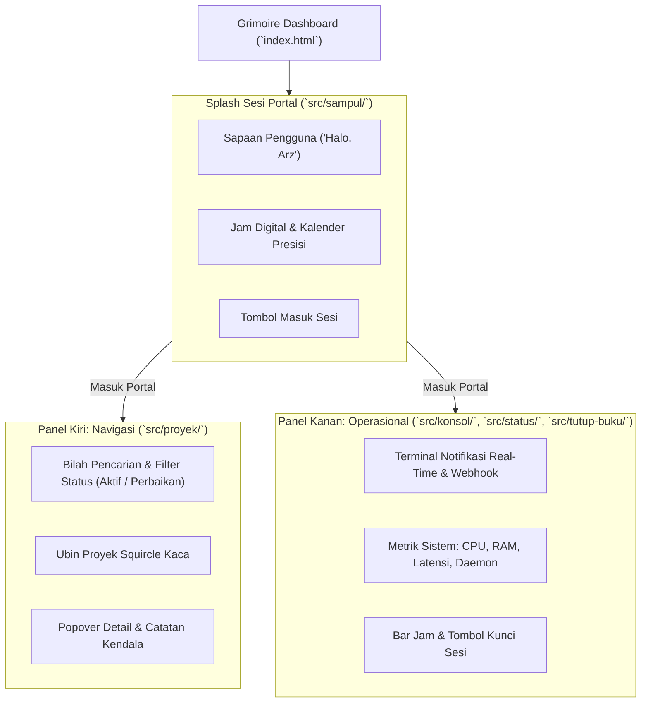
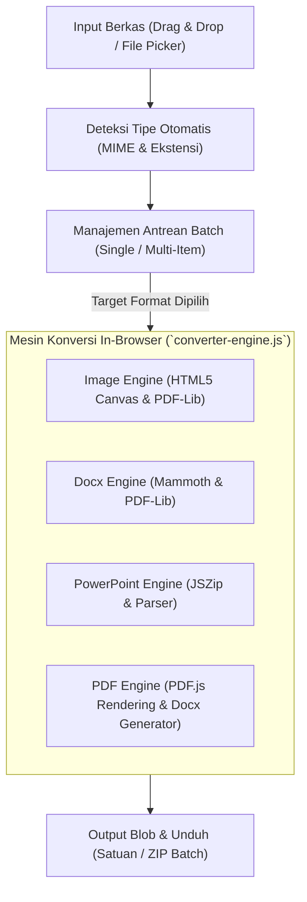

# Arz-WEB: Spesifikasi Sistem, Organisasi Folder Fitur & Dokumentasi Fitur

> [!IMPORTANT]
> ### 🎯 TUJUAN AKHIR & FILOSOFI DOKUMENTASI (`FITUR.md`)
> 1. **Membimbing AI Agent Men-deploy Website**: Dokumen ini disusun sebagai panduan arsitektur tunggal untuk membimbing AI Agent dalam merancang, membangun, mengaudit, dan **mendeploy website ke lingkungan server produksi (Nginx Home Server / CasaOS)**, **BUKAN untuk membuat aplikasi offline**.
> 2. **Offline Hanya Tahap Awal Pembuatan Fitur**: Lingkungan lokal/offline hanya berfungsi sebagai ruang kerja sementara (*staging environment*) pada tahapan paling awal saat kode dan fitur baru dirancang serta diuji sebelum siap dipublikasikan ke server web.
> 3. **Hanya Mencatat Fitur yang Telah Di-deploy & Terverifikasi**: Seluruh spesifikasi, arsitektur, selektor DOM, endpoint, dan logika yang tertuang di dalam dokumen ini **HANYA BERISI FITUR YANG TELAH AKTIF, DI-DEPLOY, DAN TERVERIFIKASI PADA WEBSITENYA** secara operasional. Seluruh komponen yang tidak aktif di server produksi tidak dicatat dalam dokumen ini.

Dokumen tunggal ini menggabungkan seluruh panduan arsitektur, konvensi organisasi direktori modular, protokol audit kebersihan proyek, serta spesifikasi teknis lengkap dari ekosistem **Arz-WEB**, yang mencakup pilar aplikasi web aktif dan modul pendukung yang terpasang:
1. **Grimoire Dashboard Utama** (`index.html`) — Portal sentral web personal berantarmuka multi-panel modern dengan desain transparan borderless glassmorphism, peluncur katalog proyek terintegrasi, pemantau telemetri metrik sistem, konsol notifikasi event live stream, dan jam digital presisi tinggi.
2. **Ethol Academic Notifier** (`ethol-notifier/`) — Modul automasi akademik berbasis engine Direct CAS SSO & REST API (Zero-Browser Overhead) serta background daemon di CasaOS: Executive Presensi Deck terpadu dengan cincin countdown radial SVG, linimasa kehadiran interaktif real-time, tray konsol diagnostik server collapsible, pemantau tenggat tugas kuliah dinamis (-7 s/d +30 hari), serta indikator visual Crimson Alert saat mode loop latar belakang aktif.
3. **Universal Converter Studio** (`converter/`) — Modul konversi dokumen dan media berkinerja tinggi yang beroperasi 100% pada peramban pengguna (*zero-server-upload*): drag-and-drop workbench, deteksi tipe MIME otomatis, mesin penggabung multi-gambar menjadi dokumen tunggal (PDF/DOCX), antrean batch interaktif, serta rendering kanvas PDF ke gambar.
*(Catatan: Purwarupa uji coba dan tester otonom QA TestSprite diisolasi secara eksklusif di `lab/` dan `testsprite_tests/` untuk lingkungan localhost dev server port 8080).*

---

## BAGIAN I: KONVENSI ORGANISASI FOLDER FITUR & ATURAN PROYEK BARU

### 1. Aturan Baku Pembuatan Projek Baru: Wajib Membuat Folder Khusus Terlebih Dahulu
> [!IMPORTANT]
> **ATURAN WAJIB PENGEMBANGAN PROYEK BARU (DEDICATED PROJECT FOLDER FIRST)**:
> Setiap kali menambahkan atau mengembangkan proyek baru, modul mandiri, atau aplikasi web dalam ekosistem **Arz-WEB**, pengembang/AI Agent **WAJIB SELALU MEMBUAT FOLDER BARU TERLEBIH DAHULU** di tingkat root repositori (contoh: `ethol-notifier/`, `converter/`, modul web baru berikutnya, dst.).
> 
> **Ketentuan Struktur Folder Proyek Mandiri:**
> 1. **Pusat Seluruh Berkas**: Seluruh berkas yang bersangkutan (halaman antarmuka `index.html`, lembar gaya `*.css`, logika script `*.js`, engine automasi/backend, cache data `*.json`, dan subfolder aset) **wajib dikumpulkan secara utuh di dalam folder proyek tersebut**.
> 2. **Dilarang Menyerakkan Berkas di Root**: Berkas kerja proyek baru tidak boleh ditaruh tercecer di root direktori. Root repositori hanya diperuntukkan bagi portal utama (`index.html` Grimoire Dashboard), file konfigurasi (`package.json`), master server (`serve.js`), skrip deployment/otomasi global (`deploy.ps1`, `Buka_Website.bat`), dan berkas aturan/dokumentasi (`Arz-WEB.md`, `FITUR.md`, `AGENTS.md`).
> 3. **Independensi & Portabilitas**: Setiap folder proyek mandiri harus dapat berfungsi mandiri, memiliki endpoint index sendiri, serta mudah dimigrasikan atau di-deploy tanpa ketergantungan silang yang membingungkan.

### 2. Struktur Pohon Berkas Terkini
```
Arz-WEB/
├── index.html                           # Entry Point: Grimoire Dashboard Portal Utama
├── serve.js                             # Local Dev HTTP & API Server (Node.js + REST Runner + Crash Guards)
├── server.js                            # Alias Entrypoint (node server.js -> serve.js)
├── serve-watchdog.js                    # Self-Healing Supervisor (Auto-Restart jika Crash / Liveness Hang)
├── Buka_Website.bat                     # Launcher 1-Klik Buka Server & Browser Otomatis
├── Buka_Website_Latar_Belakang.vbs      # Launcher Senyap Tanpa Jendela Terminal
├── Pasang_Auto_Start.bat                # Skrip Otomasi Startup Windows (Menjalankan serve-watchdog.js)
├── Hapus_Auto_Start.bat                 # Skrip Pencopot Startup Windows
├── deploy.ps1                           # Skrip Automasi Migrasi ke Nginx Home Server
├── rotate-testsprite.ps1                # Launcher & Forwarder Auto-Rotasi Akun TestSprite (Local Dev)
├── logs_buffer.json                     # Buffer persisten log presensi sukses (retensi 24 jam)
├── Arz-WEB.md                           # Master Dokumen & Spesifikasi Sistem Tematik
├── FITUR.md                             # Master Dokumen Spesifikasi Fitur Bersih & Objektif
├── README.md                            # Portofolio GitHub & Ringkasan Publik
│
├── converter/                           # FOLDER MANDIRI: Universal Converter Studio (Client-Side)
│   ├── index.html                       # Entry Point Mandiri Studio Konversi Dokumen & Media
│   ├── style.css                        # Styling Obsidian Dark Studio, Dropzone, File Cards & Responsif
│   ├── app.js                           # Controller UI, Drag & Drop, Antrean Batch & Event Handlers
│   ├── converter-engine.js              # Mesin Konversi Multi-Format (PDF-Lib, Docx, JSZip, Mammoth, PDF.js)
│   └── DESIGN.md                        # Spesifikasi Desain Antarmuka Studio Workstation
│
├── ethol-notifier/                      # FOLDER MANDIRI: Ethol Academic Notifier (Auto Presensi & Tugas)
│   ├── index.html                       # Entry Point Mandiri Ethol Notifier
│   ├── ethol.css                        # Styling dashboard glassmorphism, KPI cards, filter log, status badges
│   ├── ethol.js                         # Controller antarmuka (Self-Healing Gateway, failover, status & widget tugas)
│   ├── ethol-agent.js                   # Direct CAS SSO & REST API Engine (Auto presensi & scraper tugas)
│   ├── ethol-task-scraper.js            # Scraper mandiri penugasan perkuliahan portal ETHOL PENS
│   ├── api.php                          # Self-Healing Gateway Server (Node Health Cache, auto-failover <10ms)
│   ├── tasks.json                       # Cache data tugas kuliah mendekati deadline (-7 s/d +30 hari)
│   ├── attended_keys.json               # State persisten kunci presensi terverifikasi (retensi 90 hari)
│   ├── logs_buffer.json                 # Salinan buffer persisten log presensi subfolder ethol-notifier
│   └── screenshots/                     # Direktori tangkapan layar bukti presensi sementara (retensi 24 jam)
│
├── lab/                                 # FOLDER MANDIRI SANDBOX: Eksklusif Localhost & Modul Eksperimental
│   ├── index.html                       # Landing Hub Sandbox Laboratorium
│   └── proses-absen/                    # FITUR: Visual Absen Inspector (Step-by-Step Viewer Absensi Ethol)
│       ├── index.html                   # Halaman visualisasi kanvas ambient & timeline observasi
│       ├── proses-absen.css             # Styling dark modern, mobile touch-friendly, dynamic viewport
│       └── proses-absen.js              # Controller canonical steps, step simulator, lightbox screenshot
│
├── testsprite_tests/                    # FOLDER MANDIRI PENGUJIAN: TestSprite Automated Suite (Eksklusif Localhost)
│   ├── index.html                       # Antarmuka Web Visual: TestSprite Sentinel Hub (Localhost :8080)
│   ├── monitor.css                      # Styling Dark Glassmorphism, KPI Grid, Split Button & Responsive HP
│   ├── monitor.js                       # Controller Antarmuka, Target Selector, Live Terminal SSE & Token Manager
│   ├── backend_runner.js                # Suite Pengujian Backend Otonom (10 Skenario REST API, Gateway, Health Check)
│   ├── testsprite_vault.json            # Brankas Kredensial 15 Akun Token TestSprite
│   ├── rotate-testsprite.ps1            # Engine Rotasi & Auto-Switch Token saat Kuota Habis
│   ├── testsprite-runner.js             # Automation Runner TestSprite (Auto-Graceful Exit, Plan, Execution)
│   ├── code_summary.yaml                # Rangkuman Kode & Arsitektur Grimoire Dashboard
│   ├── standard_prd.json                # Standardized PRD Hasil Analisis TestSprite Cloud
│   ├── testsprite_frontend_test_plan.json # Rencana Pengujian Frontend 21 Kasus Uji (TC001 - TC021)
│   ├── DOKUMENTASI_PERBAIKAN_TESTSPRITE.md # Laporan Komparasi Sebelum vs Sesudah Perbaikan Uji
│   └── tmp/                             # Direktori Kerja Sementara, Test Scripts (.py), & Log Eksekusi
│
└── src/
    ├── proyek/                          # FITUR: Katalog & Peluncur Proyek Web
    │   ├── proyek.css                   # Styling glassmorphic tiles, filter status & modal popover
    │   └── proyek.js                    # Render dinamis daftar proyek dan peluncur tautan
    │
    ├── konsol/                          # FITUR: Konsol Notifikasi & Webhook
    │   ├── konsol.css                   # Antarmuka terminal log bernuansa translucent glass
    │   └── konsol.js                    # Webhook listener dan simulasi log aktivitas
    │
    ├── sampul/                          # FITUR: Splash Screen Landing & Jam Presisi
    │   ├── sampul.css                   # Desain modal overlay transparan borderless & jam presisi
    │   ├── sampul.js                    # Interaktivitas buka sesi portal dan live digital clock
    │   └── book_cover.png               # Aset latar grafis portal utama
    │
    ├── status/                          # FITUR: System Health Metrics & Telemetri
    │   ├── status.css                   # Panel metrik kesehatan sistem glassmorphic
    │   └── status.js                    # Kalkulasi live telemetri CPU, RAM, Latensi, Modul
    │
    ├── tutup-buku/                      # FITUR: Kontrol Kunci Sesi & Clock Bar
    │   ├── tutup-buku.css               # Desain tombol kunci sesi & bar jam digital terpusat
    │   └── tutup-buku.js                # Interaktivitas tombol kunci sesi portal
    │
    └── shared/                          # SHARED: Khusus utilitas lintas ≥2 fitur
        ├── shared.css                   # Variabel warna sistem, glassmorphic styling, global layout
        ├── utils.js                     # Helper manipulasi DOM & formatting teks
        ├── audio.js                     # Web Audio API sintetis untuk notifikasi audio feedback
        ├── book_open.png                # Aset bingkai latar layout dashboard utama (Desktop)
        ├── book_page_left.png           # Aset latar panel kiri navigasi (Mobile UI Pertama)
        └── book_page_right.png          # Aset latar panel kanan status & konsol (Mobile UI Kedua)
```

### 3. Aturan Penamaan & Folder `shared/`
- **Penamaan Folder**: Gunakan kata benda fungsi yang deskriptif dan konsisten (misal: `proyek/`, `konsol/`, `sampul/`, `status/`, `tutup-buku/`). Dilarang menggunakan nama layer abstrak di root seperti `controllers/`, `views/`, atau `models/`.
- **Folder `shared/`**: Hanya digunakan jika kode/aset dipakai oleh **2 fitur atau lebih** (misal generator audio Web Audio API, latar layout, variabel tema global). Jika hanya dipakai 1 fitur, wajib masuk ke folder fitur tersebut secara terlokalisasi.

### 4. Protokol WAJIB: Pembersihan Berkas Usang Pasca-Generate (Pruning Protocol)
> **ATURAN MUTLAK:**
> Setiap kali selesai melakukan generate kode, penambahan fitur, atau refactoring:
> **Jika ada berkas atau folder lama yang tidak digunakan lagi, tidak dimunculkan di website, atau sudah digantikan oleh fitur baru, berkas/folder tersebut WAJIB SEGERA DIHAPUS.**

#### Kriteria Berkas yang Wajib Dihapus:
1. **Fitur yang Telah Diganti**: Berkas fitur lama yang UI-nya sudah tidak ditampilkan lagi di halaman web.
2. **Tidak Dimuat di Entry Point**: Script (`.js`) atau style (`.css`) yang tidak lagi di-link pada `index.html`, `ethol-notifier/index.html`, atau `converter/index.html`.
3. **Duplikat Aset**: Gambar/media yang pernah tercecer di root atau folder acak setelah dipindahkan ke folder fitur resmi.
4. **Berkas Sampah / Eksperimen**: Berkas pengujian sementara (`test_*.txt`, scratchpad, berkas spec draft usang).

#### Prosedur Audit Pembersihan:
1. Periksa entry point (`index.html`, `ethol-notifier/index.html`, `converter/index.html`, `serve.js`). Catat seluruh berkas yang aktif dimuat.
2. Bandingkan dengan struktur direktori fisik proyek.
3. Hapus bersih berkas/folder yang tidak terpakai menggunakan perintah permanen (`Remove-Item -Force`).
4. Verifikasi bahwa server berjalan normal tanpa error 404 pada network tab peramban.

### 5. Pelaporan Transparan Perubahan Berkas
Setiap asisten/pengembang wajib menyajikan laporan ringkasan berkas setelah melakukan modifikasi:
```markdown
### 📋 Ringkasan Pembaruan Berkas:
#### ➕ Berkas / Folder yang Ditambahkan:
- `path/file` — [Keterangan fungsi]
#### 🗑️ Berkas / Folder yang Dihapus (Pembersihan Berkas Usang):
- `path/file` — [Alasan penghapusan]
#### 🛡️ Status Integritas:
- [Pengecekan broken link / HTTP 200 status]
```

### 6. Checklist Cepat Sebelum Menyelesaikan Tugas
- [x] Semua berkas fitur baru berada dalam satu folder terisolasi (`src/<fitur>/` atau `<modul-mandiri>/`).
- [x] Fitur terhubung sempurna pada entry point aplikasi terkait.
- [x] **Audit pembersihan tuntas**: Berkas usang dan draft lama telah dihapus.
- [x] Tidak ada aset duplikat yang tercecer.
- [x] Laporan transparansi berkas telah disajikan.

---

### 7. Protokol Otomasi Migrasi ke Website (Keyword Trigger: "pw" / "pindahkan ke website")
> **STANDAR OPERASIONAL PROSEDUR (SOP MUTLAK):**
> Jika pengguna memberikan instruksi atau perintah dengan kata kunci **"pw"** (perintah pintas resmi) atau variasi serupa (*"pindahkan ke website"*, *"deploy ke server"*, *"sinkronkan ke web"*, *"upload ke website"*):
> 
> Asisten AI **WAJIB MENJALANKAN 5 PILAR UTAMA SECARA OTOMATIS** tanpa meminta konfirmasi berulang:
> 1. **Pilar 1: Pre-Deployment Testing Gate (TestSprite Automated Test Gate)**: Menjalankan verifikasi uji otomatis TestSprite terlebih dahulu terhadap web yang akan di-deploy sebelum mengizinkan proses transfer berkas.
> 2. **Pilar 2: Audit & Transformasi UI Android / Mobile (Android-Fit Protocol)**: Memastikan UI bebas horizontal overflow, target sentuh minimal 48px, Fitts' law thumb-zone, dan viewport `100dvh`.
> 3. **Pilar 3: Auto-Update Berkas Dokumentasi (`Arz-WEB.md`, `FITUR.md`, `README.md`)**: Wajib secara otomatis memperbarui berkas dokumentasi mencakup header pilar ekosistem dan spesifikasi teknis modul. Riwayat pembaruan dialihkan sepenuhnya ke Git Commit History di GitHub.
> 4. **Pilar 4: Sinkronisasi Git Commit & Push ke GitHub Portofolio (VCS Sync Gate)**: Menjalankan komit atomik dan push ke repositori GitHub.
> 5. **Pilar 5: Eksekusi Deployment Otomatis ke Nginx Home Server**: Menyalin seluruh berkas aktif proyek ke Nginx Home Server via `deploy.ps1`.

#### 🧪 Pilar 1: Pre-Deployment Testing Gate (TestSprite Automated Test Gate)
Sebelum berkas disinkronkan ke server web produksi Nginx, sistem WAJIB melakukan verifikasi pengujian otomatis:
1. **Verifikasi Web Target**: Memastikan halaman web yang hendak di-deploy telah divalidasi skenario ujinya melalui:
   ```powershell
   node testsprite_tests/testsprite-runner.js runTests
   ```
2. **Kondisi Penghentian (Abort Condition)**: Jika terjadi kegagalan fatal/kritis pada pengujian:
   - Proses deployment ke Nginx **DIBATALKAN SECARA OTOMATIS** (*deployment aborted*).
   - Status shortcut proyek terkait di `src/proyek/proyek.js` otomatis diubah menjadi **"Perbaikan"** (`wip`) disertai catatan kendala.
3. **Syarat Kelolosan (Pass to Deploy)**: Hanya kode yang lolos pengujian tanpa error fungsional kritis yang diizinkan melangkah ke tahap deployment server.

#### 📱 Pilar 2: Audit & Transformasi UI Android / Mobile (Android-Fit Protocol)
Sebelum berkas dipindahkan ke website publik, seluruh antarmuka yang diubah/ditambahkan WAJIB lolos audit tampilan smartphone (viewport ~360px - 480px / 390x844):
1. **Dynamic Viewport Unit (`100dvh` / `100svh`)**: Menggunakan `min-height: 100dvh;` pada kontainer root agar layout tidak terpotong oleh dynamic URL bar browser Android.
2. **Android Safe Area Insets**: Seluruh header dan bottom container mengadopsi `env(safe-area-inset-top)` dan `env(safe-area-inset-bottom)`.
3. **Target Sentuh Ergonomis (Minimal 48px)**: Seluruh tombol aksi, tab switcher, dan kontrol navigasi memiliki area sentuh minimal **48px × 48px** dengan gap sentuh 8px–12px (mencegah *fat-finger error* sesuai Material Design 3).
4. **Zona Jempol (Fitts' Law Thumb-Zone)**: Aksi-aksi utama dan navigasi prioritas dirancang nyaman untuk sepertiga bawah layar yang mudah dijangkau satu jempol.
5. **Anti-Pull-to-Refresh & Tap Delay**: Mencegah browser me-refresh tak sengaja via `overscroll-behavior-y: contain;` dan `touch-action: manipulation;`.
6. **Bebas Horizontal Overflow**: `max-width: 100vw; overflow-x: hidden;` dengan seluruh tabel data dibungkus dalam `.table-scroll-container` (`-webkit-overflow-scrolling: touch;`).

#### 📝 Pilar 3: Auto-Update Berkas Dokumentasi & Pengalihan Riwayat ke GitHub
Setiap kali migrasi dipicu, Asisten AI **WAJIB secara otomatis memperbarui dokumentasi**:
1. **Pembaruan Ringkasan Fitur Ekosistem (Header & Overview)**: Memastikan daftar seluruh pilar aplikasi web aktif selalu mutakhir.
2. **Pembaruan Seksi Spesifikasi Teknis**: Menambahkan seksi spesifikasi teknis baru jika terdapat modul baru (seperti modul konverter dokumen atau perubahan arsitektur).
3. **Pengalihan Riwayat ke GitHub**: Seluruh riwayat perubahan dialihkan ke Git Commit History di GitHub portofolio (`https://github.com/RadenArya1/Arz-WEB/commits/main`).

#### 🐙 Pilar 4: Sinkronisasi Git Commit & Push ke GitHub Portofolio
1. Eksekusi komit dan push otomatis:
   ```powershell
   git add .
   git commit -m "feat/fix/chore: deskripsi ringkas perubahan"
   git push origin main
   ```
2. **Zero-Leak Policy**: Memastikan berkas brankas sensitif TestSprite, token kredensial (`ethol-config.json`), dan berkas sementara tetap terisolasi penuh via `.gitignore`.

#### 🚀 Pilar 5: Eksekusi Otomatis Penyalinan Berkas ke Server Nginx
1. **Jalur Target Server**:
   - Jalur Akses Jaringan (SMB UNC Path): `\\100.73.128.8\Data\AppData\nginx\config\www`
   - Lingkungan Web Server: Nginx Container pada CasaOS Home Server.
   - Tautan Publik:
     - Grimoire Dashboard Utama: `https://dashboard.raidenarya.my.id/`
     - Ethol Notifier: `https://dashboard.raidenarya.my.id/ethol-notifier/`
2. **Berkas yang Disinkronkan**:
   - `index.html` (Grimoire Dashboard Portal)
   - `ethol-notifier/` (Modul Mandiri Ethol Notifier)
   - `converter/` (Modul Mandiri Universal Converter Studio)
   - Seluruh folder `src/` (modul fitur, assets, CSS, JS)
3. **Isolasi Mutlak Berkas Lokal**:
   - Berkas `testsprite_tests/`, `testsprite_vault.json`, `rotate-testsprite.ps1`, `testsprite-runner.js`, `mcp_config.json`, `.agents/`, `serve.js`, `server.js`, `serve-watchdog.js`, `deploy.ps1`, dan folder `.git` **DILARANG KERAS DIPUBLIKASIKAN KE SERVER NGINX PUBLIK**.
4. **Perintah Eksekusi Otomatis**:
   ```powershell
   powershell.exe -ExecutionPolicy Bypass -File ".\deploy.ps1" -PushGit
   ```

---

### 8. Aturan Baku Manajemen Shortcut Katalog Proyek & Siklus Status
> **STANDAR OPERASIONAL PROSEDUR (SOP KATALOG PROYEK):**
> Berlaku mutlak pada setiap pembuatan fitur/modul web baru serta setiap kali terjadi masalah (bug/error/offline) pada suatu website di repositori Arz-WEB:

#### A. Otomatis Membuat Shortcut saat Fitur Baru Dibuat
- Setiap kali membuat halaman web, modul mandiri, atau aplikasi baru di repositori Arz-WEB, **WAJIB secara otomatis mendaftarkan shortcut proyek baru** ke dalam Katalog Proyek Grimoire Dashboard (`src/proyek/proyek.js`).
- Setiap entri shortcut wajib memiliki: `id`, `title`, `icon` (FontAwesome representatif), status awal (`active` / `wip`), `statusLabel`, deskripsi singkat, `target` host, `url` navigasi, dan `tags`.

#### B. Eliminasi Total Status "Ide" (Hanya Ada 2 Status Baku)
Katalog Proyek **hanya mengenal 2 status operasional**:
1. **Aktif** (`status: 'active'`, `statusLabel: 'Aktif'`, warna Zamrud / Emerald Green):
   - Menandakan fitur/web beroperasi normal, stabil, responsif, dan siap digunakan.
2. **Perbaikan** (`status: 'wip'`, `statusLabel: 'Perbaikan'`, warna Warm Amber):
   - Menandakan fitur/web sedang dalam pengerjaan, mengalami kendala teknis, bug, offline backend, atau sedang dalam masa pemeliharaan.
- **Status "Ide" telah dihapus secara permanen** dari antarmuka, tombol filter kategori, dan skrip data.

#### C. Deteksi Masalah & Auto-Update Status Shortcut
- **Saat Terjadi Masalah / Bug:** Apabila pada suatu website/fitur yang telah dibuat terjadi kendala, bug, error API, kegagalan render, atau layanan backend terputus, Asisten AI **WAJIB secara otomatis memperbarui status shortcut proyek terkait menjadi "Perbaikan"** (`wip`) di `src/proyek/proyek.js`, serta menyertakan rincian kendala pada properti `note`.
- **Saat Masalah Berhasil Diperbaiki:** Setelah kendala tuntas diperbaiki dan diverifikasi normal, Asisten AI **WAJIB secara otomatis mengembalikan status shortcut proyek menjadi "Aktif"** (`active`) dan menghapus catatan kendala (`note`).
- **Programmatic API:** Tersedia fungsi global `window.setProjectStatus(idOrUrl, status, note)` dan `window.registerProjectShortcut(projectData)` pada `src/proyek/proyek.js` untuk integrasi status real-time lintas modul.

#### D. Keunikan Ikon Shortcut Wajib (Anti-Duplikasi Ikon & Registri Resmi)
- Setiap shortcut ubin di dalam Katalog Proyek **WAJIB memiliki ikon FontAwesome yang unik dan berbeda** satu sama lain.
- **Dilarang keras memakai ikon yang sama atau bermakna kembar** untuk dua atau lebih proyek web yang berbeda.
- **Tabel Registri Ikon Resmi Proyek:**
  | ID Proyek | Nama Proyek Web | Ikon FontAwesome | Representasi Fungsional |
  | :--- | :--- | :--- | :--- |
  | `proj_ethol_sync` | Ethol Academic Notifier | `fa-calendar-check` | Kalender jadwal kuliah & automasi presensi terverifikasi |
  | `proj_student_web` | Student Website & Expense Tracker | `fa-building-columns` | Portal akademik mahasiswa & tracker nota OCR |
  | `proj_grimoire_ui` | Grimoire Dashboard - Arz | `fa-book-skull` | Portal kendali utama & peluncur ekosistem web |
  | `proj_converter_studio` | Universal Converter Studio | `fa-arrows-rotate` | Mesin konversi dokumen & media multi-format client-side |
  | `proj_testsprite_sentinel` | TestSprite Sentinel Hub | `fa-vial-circle-check` | QA pengujian otonom dual-suite & monitoring token |
  | `proj_alchemist_wiki` | Alchemist Study Notes & Wiki | `fa-feather-pointed` | Sistem dokumentasi studi & catatan perkuliahan Markdown |
  | `proj_task_bot` | AutoTask Telegram Bot | `fa-robot` | Automasi cerdas & push alert bot pengingat tugas |
  | `proj_absen_inspector` | Visual Absen Inspector | `fa-binoculars` | Observasi visual alur automasi presensi per tahap |

---

## BAGIAN II: SPESIFIKASI PORTAL DASHBOARD UTAMA (GRIMOIRE DASHBOARD - `index.html`)

Portal utama berfungsi sebagai pusat navigasi ekosistem web dengan arsitektur multi-panel interaktif dan antarmuka **Transparan Penuh (Borderless Translucent Glassmorphism)**:



### 1. Desain Antarmuka Transparan Borderless (Glassmorphism & Clean Surface)
- **Eliminasi Panel Pekat**: Bingkai kotak `.book-panel` berlatar solid dihilangkan total (`background: transparent; border: none; box-shadow: none; backdrop-filter: none;`). Seluruh konten katalog proyek, konsol log, jam digital, dan status telemetri menempel langsung di atas permukaan kanvas transparan berlapis halus.
- **Cache-Buster Query Versioning**: Seluruh tag stylesheet di-link dengan query versioning `?v=20260913_transparan` guna memastikan peramban memuat gaya transparan terbaru tanpa terkena cache lawas.

### 2. Splash Screen Landing ("Portal Pribadi" 1:1 Precision Coordinate Lock)
- **Pembersihan Elemen Non-Fungsional**: Ornamen hiasan garis atas dan teks petunjuk klik dihapus permanen dari DOM untuk menyajikan tampilan minimalis dan fokus.
- **Penguncian Koordinat Presisi Vertikal**: Posisi elemen di dalam `.book-overlay-center` dikunci menggunakan persentase vertikal tetap:
  - Judul sapaan pengguna (`.user-greeting-box`): `top: 17.53%;`
  - Jam digital dan tanggal (`.time-widget-box`): `top: 37.40%;`
  - Tombol masuk portal (`.btn-enter-grimoire`): `top: 71.43%;`
  Hal ini mengunci layout secara presisi 1:1 sehingga sapaan pengguna, jam digital, dan tombol masuk tetap stabil di koordinat yang sama tanpa pergeseran layout sedikit pun (*zero layout shift*).

### 3. Panel Kiri: Katalog Proyek Web (`src/proyek/`)
- **Ubin Squircle Kaca (*Glassmorphic Tiles*)**: Ubin peluncur proyek menggunakan gradien transparan berkilau lembut sesuai 2 status resmi:
  - **Aktif (Badge Zamrud)**: `linear-gradient(135deg, rgba(220, 248, 226, 0.45), rgba(187, 238, 198, 0.28))` berborder hijau menyala lembut dengan denyut hijau (`pulseGreen`).
  - **Perbaikan (Badge Amber)**: `linear-gradient(135deg, rgba(254, 243, 199, 0.45), rgba(253, 230, 138, 0.28))` berborder oranye amber dengan denyut amber (`pulseAmber`).
- **Bilah Pencarian & Filter Kategori**:
  - Toolbar pencarian transparan `rgba(245, 235, 215, 0.22)` dengan `backdrop-filter: blur(8px)`.
  - Input field semi-transparan `rgba(255, 255, 255, 0.38)`.
  - Tab filter kategori instan pill: `[Semua] [● Aktif] [● Perbaikan]` berlatar kaca lembut dengan aksen amber pekat saat aktif.
- **Tooltip Popover & Catatan Kendala**: Popover info proyek berlatar kaca lembut dengan blur tinggi (`12px`). Jika shortcut berada dalam status *Perbaikan*, popover secara otomatis menampilkan lencana catatan kendala (`popover-note-badge`) berisi keterangan masalah teknis yang sedang ditangani.
- **Auto-Sync Shortcut**: Terintegrasi langsung dengan `window.GrimoireCatalog` untuk penambahan shortcut otomatis saat fitur baru dibangun dan pembaruan status dinamis saat kendala terdeteksi.

### 4. Panel Kanan Atas: Konsol Notifikasi & Webhook (`src/konsol/`)
- **Layar Terminal Log Transparan**: Mengadopsi kaca terminal transparan `rgba(12, 22, 15, 0.48)` dengan `backdrop-filter: blur(10px)`.
- **Status Telemetri & Filter**: Menjaga denyut hijau telemetri (*Daemon Listening Aktif*) di atas ubin transparan ber-border lembut. Tab filter log (`Semua`, `Info`, `Sukses`, `Peringatan`, `Event`) mendukung *horizontal touch swipe*.
- **Interactive Input Bar**: Bar prompt teks transparan kaca `rgba(255, 255, 255, 0.35)` dengan aksen kontras. Pengguna dapat mengetik perintah seperti `help` atau pesan kustom untuk dicatat langsung ke konsol.

### 5. Panel Kanan Bawah: Status Telemetri Sistem & Kunci Sesi (`src/tutup-buku/` & `src/status/`)
- **Widget Metrik Telemetri Sistem**: Berlatar kaca transparan `rgba(255, 250, 240, 0.22)` dengan 4 ubin metrik telemetri (Core Engine, RAM, Latensi, Modul) menggunakan ubin kaca transparan `rgba(255, 255, 255, 0.32)` berbingkai border halus.
- **Kotak Sesi & Jam Digital**: Bar horizontal ramping berisi jam digital terpusat berlatar kaca transparan `rgba(255, 255, 255, 0.3)` dengan tanggal di bawahnya, serta tombol **"KUNCI SESI / TUTUP"** berefek shimmer yang mengembalikan tampilan ke splash screen landing.
- **Navigasi Layar Smartphone (Mobile FAB)**: Tombol melayang elegan di sudut kanan bawah untuk berpindah mulus antara Panel Kiri (Katalog Proyek) dan Panel Kanan (Konsol & Status) dengan visual transisi yang responsif.

---

## BAGIAN III: SPESIFIKASI ETHOL ACADEMIC NOTIFIER (`ethol-notifier/`)

Modul automasi akademik mandiri (**Ethol Academic Notifier**) beroperasi sebagai pengawas perkuliahan otomatis dan asisten presensi cerdas:

### 1. Arsitektur Mandiri, Direct REST API Daemon & Backend 24/7
- **Folder Khusus Mandiri (`ethol-notifier/`)**: Seluruh komponen frontend (`index.html`, `ethol.css`, `ethol.js`) dan backend agent (`ethol-agent.js`, `tasks.json`, `attended_keys.json`) tersimpan terisolasi di dalam satu folder root.
- **Direct CAS SSO & REST API Engine (Zero-Headless Browser)**: Terinspirasi dari arsitektur daemon Go (`repinger/ethold`), otomasi presensi tidak lagi menggunakan peramban headless Puppeteer yang berat. Sebagai gantinya, engine mengeksekusi autentikasi SSO CAS (`login.pens.ac.id`) via HTTP Form POST langsung dengan CookieJar in-memory, dilanjutkan pemanggilan REST API internal `/api/presensi/aktif-kuliah` dan `/api/presensi/mahasiswa`. Konsumsi RAM terpangkas dari ~350MB menjadi < 30MB dan waktu eksekusi memuncak dari ~30 detik menjadi hanya ~2.3 detik.
- **Atomic State Persistence (`attended_keys.json`)**: Mencegah pengiriman token presensi ganda melalui berkas state JSON dengan mekanisme atomic lock dan auto-pruning berkala (retensi 90 hari / setara 1 semester akademik).
- **Nginx Reverse Proxy API**: Seluruh panggilan frontend ke backend diarahkan melalui reverse proxy Nginx (`/api/absen/` -> `172.20.0.1:8080`) dengan `API_BASE` dinamis guna mencegah kendala *Mixed Content* di domain HTTPS publik `https://dashboard.raidenarya.my.id/`.

### 2. Mekanisme Presensi Perkuliahan Berkecepatan Tinggi (Direct API)
- **Autentikasi SSO CAS PENS**: Login aman menggunakan kredensial terkonfigurasi, ekstraksi token formulir `fm1`, perolehan tiket service CAS, dan validasi profil token mahasiswa (`/api/auth/validasi-token`).
- **Concurrent Scanning (Paralel via `Promise.all`)**: Memindai seluruh mata kuliah aktif secara bersamaan, mendeteksi ketersediaan sesi kehadiran, dan langsung mengirimkan token presensi mahasiswa secara instan.
- **Anti-Duplikasi & Deduplikasi Lokal**: Apabila sesi kuliah sudah pernah dihadiri hari ini atau tercatat dalam `attended_keys.json`, engine secara otomatis melewati submission dan melaporkan status hadir ke konsol.

### 3. Integrasi Konsol Output, Persistensi Buffer & Retensi Sementara 24 Jam
- **Pencatatan Presensi Terverifikasi**: Hasil presensi yang sukses diformat ke standar konsol `[SUKSES] ✓ Presensi Berhasil Tercatat — {Matakuliah} | Dosen: {Dosen} | Waktu: {Waktu}` sehingga otomatis dikenali oleh `serve.js` `isPresensiSuccess()`.
- **Tampilan Konsol & Timeline Interaktif**: Presensi disajikan dalam kartu interaktif di linimasa visual lengkap dengan lencana terverifikasi (`PRESENSI BERHASIL`), rincian nama dosen, dan countdown waktu aktif.
- **Persistensi Buffer & Auto-Pruning 24 Jam**: Buffer log presensi tersimpan persisten ke berkas `logs_buffer.json` di server agar tidak hilang saat server/container restart, disaring secara ketat dalam jangka waktu 24 jam terakhir.

### 4. Konsol Notifikasi Khusus Presensi Berhasil & SSE Live Stream
- **Filter Ketat Presensi Berhasil & Batas Waktu Maksimal 1 Hari (24 Jam)**: Konsol output frontend (`ethol-notifier/ethol.js`) dan konsol Grimoire Dashboard (`src/konsol/konsol.js`) secara ketat hanya menampilkan catatan presensi kuliah yang sukses dan tercatat hadir (`isPresensiSuccess()`) **yang terjadi dalam kurun waktu 1 hari (24 jam) terakhir**. Seluruh catatan presensi yang telah berumur lebih dari satu hari secara mutlak tidak ditampilkan ke DOM konsol, otomatis disaring dari feed SSE/REST (`api.php`, `serve.js`), serta dibersihkan secara real-time melalui auto-pruning interval 30 detik tanpa perlu merefresh halaman.
- **SSE Real-Time Stream**: Antarmuka terhubung ke endpoint `/api/absen/log-stream` untuk menerima telemetri log langsung dari server secara live tanpa polling blocking.
- **Sintesis Audio Feedback**: Menghasilkan nada audio alert menggunakan Web Audio API sintetis saat notifikasi sukses presensi diterima.

### 5. Pengingat Tugas Kuliah (Jendela Waktu -7 s/d +30 Hari & Filter Selesai Ketat)
- **Scraper & REST API Tugas Akademik**: Memantau penugasan kuliah dari portal ETHOL dengan interval berkala saat sesi login aktif.
- **Filter Status Selesai Ketat**: Mengeliminasi seluruh tugas yang telah selesai dikumpulkan (`submission_time` terisi, berkas pengumpulan terunggah `submission_file`, status selesai, atau tugas yang telah ditutup dosen `tutup === 1`).
- **Jendela Waktu Tenggat Dinamis (-7 Hari s/d +30 Hari)**: Menampilkan tugas aktif belum selesai yang memiliki sisa waktu hingga **30 hari ke depan (1 bulan mendatang)** dengan toleransi **1 minggu sebelum (maksimal terlambat 7 hari ke belakang)**. Tugas kadaluwarsa masa lampau (> 7 hari lalu) otomatis dieliminasi dari `tasks.json`.
- **Mode Eksekusi CLI Modular (`--tasks-only` & `--absen-only`)**: Engine `ethol-agent.js` mendukung pemanggilan tersegmentasi melalui argumen CLI: flag `--tasks-only` memfokuskan siklus pemindaian hanya pada katalog tugas perkuliahan tanpa memicu presensi kelas, sedangkan `--absen-only` mengeksekusi sesi kehadiran aktif tanpa memindai tugas.
- **Integrasi Server Daemon Runner (`serve.js`)**: Pemindaian berkala penugasan latar belakang di `serve.js` (`runTaskAgent()`) memanfaatkan `ethol-agent.js --tasks-only` sebagai runner utama berkecepatan tinggi dengan fallback otomatis ke `ethol-task-scraper.js`.
- **Label Tag Urgensi Cerdas (`calculateHTag`)**: Lencana urgensi menampilkan feedback dinamis yang akurat: `Hari Ini` (saat tenggat jatuh pada hari pemindaian), `H-${diffDays}` (untuk tugas masa depan), serta rincian durasi keterlambatan `Terlambat (${diffDays}h lalu)`.
- **Widget Kartu Tugas & Indikator Status**: Menampilkan nama mata kuliah, dosen pengampu, dan judul tugas dengan feedback visual status aman jika seluruh tugas aktif telah diselesaikan.

### 6. Mode Loop Otomatis di Latar Belakang & Crimson Red Alert Theme
- **Backend Daemon Loop & Auto-Reschedule Resilience**: Mode loop berjalan persisten di server Node.js (`/api/absen/loop/start`). Penutupan tab atau browser tidak menghentikan putaran pengecekan berkala (interval acak 3 - 5 menit). Daemon `serve.js` dilengkapi auto-reschedule pada seluruh event kegagalan (`proc.on('error')` dan non-zero exit code), serta menyiarkan rincian status error `lastRunError` ke endpoint status dan klien SSE.
- **Penyelarasan Kredensial CasaOS Terisolasi**: Berkas kredensial SSO `ethol-config.json` disinkronkan khusus ke folder privat backend CasaOS (`/DATA/AppData/ethol-backend/`), menjamin eksekusi loop mandiri 24/7 di server tanpa ketergantungan pada laptop, sekaligus menjaga folder web publik Nginx (`nginx/config/www/`) tetap 100% bersih dan aman dari kebocoran berkas konfigurasi.
- **Transisi Visual Tema Crimson Alert**: Antarmuka beralih secara dinamis dari obsidian cyan ke velvet crimson saat mode loop aktif. Dilengkapi live countdown ticker, auto-trigger polling status saat countdown selesai (`diffMs <= 0`), serta feedback visual jujur jika backend mengalami kegagalan (badge `ERROR` merah dan deskripsi peringatan).

### 7. Optimalisasi Tampilan HP & Eliminasi Scroll Trap (Mobile-First Architecture)
- **Eliminasi Total Scroll Trap**: Menerapkan `overflow-x: clip !important`, `overscroll-behavior-y: auto !important`, dan `-webkit-overflow-scrolling: touch` pada `html`, `body.ethol-body`, dan `.deck-wrapper`, mencegah isolasi gestur sentuh browser Android Chrome dan memastikan navigasi gulir atas/bawah bebas hambatan tanpa locking.
- **Dynamic Bottom Clearance**: Menambahkan `padding-bottom: calc(130px + env(safe-area-inset-bottom, 20px))` pada `.deck-wrapper` sehingga bilah aksi jempol mengambang (`.mobile-action-bar`) tidak menutupi kartu profil, tombol kontrol, maupun linimasa presensi.
- **Header Adaptif Anti-Truncate**: Menyembunyikan badge `Ops Deck` pada breakpoint mobile (≤ 768px & ≤ 640px) serta mengoptimalkan lebar tombol navigasi kembali (`white-space: nowrap; flex-shrink: 0;`), menjamin tombol tidak terpotong pada viewport sempit (≤ 480px / 384px Android).
- **Hero Operational Status Hub Grid 3-Zona**: Mengadopsi CSS Grid 3 zona (`header`, `ring & desc`, `metrics`) pada `.status-radial-hub` mobile, memastikan countdown ring dan teks deskripsi tersusun simetris serta dua metrik (*Eksekusi Terakhir* & *Hasil Terakhir*) tertata seimbang dalam 2 kolom sejajar tanpa dead-space.

### 8. Arsitektur Pemulihan Mandiri (Self-Healing Architecture) & Watchdog Supervisor
- **Frontend GatewayManager Adaptif (`ethol.js`)**: Mengeliminasi ketergantungan pada satu rute statis dengan mekanisme failover multi-kandidat otomatis: (1) `/ethol-notifier/api.php?path=` (FastCGI PHP Gateway), (2) `/api/absen/` (Nginx reverse proxy), (3) direct Tailscale IP (`http://100.73.128.8:8080`), dan (4) localhost. Setiap pemanggilan `fetchJson()` secara cerdas memvalidasi `content-type: application/json` untuk mendeteksi respons keliru dan langsung mengalihkan rute secara transparan tanpa toast galat ke pengguna.
- **Node Health Cache Gateway Server (`api.php`)**: Memanfaatkan berkas `node_health.json` untuk mencatat metrik latensi dan riwayat kegagalan setiap node secara real-time. Jika node laptop offline, gateway langsung meneruskan permintaan ke container Docker CasaOS (`http://172.20.0.1:8080`) dalam waktu < 10 milidetik.
- **Node.js Self-Healing Watchdog (`serve-watchdog.js`)**: Supervisor mandiri yang membungkus eksekusi `serve.js`. Mengawasi status hidup proses, melakukan *liveness ping* HTTP setiap 25 detik, dan otomatis merestart instance server jika terjadi crash, hang, atau memori jenuh. Diintegrasikan langsung pada `Pasang_Auto_Start.bat`.
- **Global Crash Guards (`serve.js`)**: Mencegah proses Node.js mati tiba-tiba dengan memasang penanganan terpusat `process.on('uncaughtException')` dan `process.on('unhandledRejection')` serta endpoint pemantauan kesehatan `/api/absen/health`.

### 9. Filter Anti-Duplikasi Konsol Output (Deduplikasi Data Masuk)
- **Registry Tanda Tangan Entri (`renderedLogSignatures` & `getPresensiSignature()`)**: Setiap entri presensi dihitung tanda tangan uniknya berdasarkan nama berkas screenshot spesifik dan normalisasi teks matakuliah/toleransi waktu. Data yang tanda tangannya sudah tercatat di registry konsol output maupun elemen DOM secara mutlak ditolak dan tidak akan pernah disisipkan ulang.
- **Pencegahan Redundansi Notifikasi & Chime**: Sinkronisasi berkala (`syncLogs()`) setiap 1.5 detik dan rekoneksi SSE stream tidak memicu audio feedback atau notifikasi push ganda pada data presensi yang sudah tertampil di layar.
- **Deduplikasi Server Buffer & FastCGI Gateway**: Buffer `logs_buffer.json` saat start server dan pemanggilan `pushLog()` pada `serve.js`, serta gateway `api.php`, secara proaktif menyaring catatan presensi duplikat sebelum disiarkan ke client.

---

## BAGIAN IV: SPESIFIKASI UNIVERSAL CONVERTER STUDIO (`converter/`)

Modul **Universal Converter Studio** beroperasi sebagai workstation konversi dokumen dan media berkecepatan tinggi yang sepenuhnya berjalan di sisi peramban pengguna (*Client-Side Web Workstation*):



### 1. Arsitektur Client-Side Zero-Server-Upload (100% In-Browser Privacy)
- **Keamanan Data Mutlak**: Pemrosesan konversi berlangsung seutuhnya di memori peramban (*RAM-only execution*). Berkas pengguna tidak pernah diunggah ke server backend mana pun, menjamin privasi dokumen sensitif dan kecepatan instan tanpa latensi transfer jaringan.
- **Pustaka Tanpa Ketergantungan Server**:
  - `pdf-lib` (v1.17.1): Sintesis dokumen PDF, manipulasi halaman, penyisipan gambar, dan pembuatan embedding dokumen.
  - `docx` (v8.5.0): Generator file biner Word (.docx) berbasis OpenXML client-side.
  - `mammoth` (v1.6.0): Parser pembaca konten dan format berkas docx ke teks/HTML murni.
  - `jszip` (v3.10.1): Dekompresi arsip dokumen OpenXML (pptx/docx) serta generator arsip ZIP untuk unduh batch.
  - `pdfjs-dist` (v3.11.174): Engine rendering dokumen PDF per halaman ke kanvas HTML5 untuk konversi PDF ke format gambar resolusi tinggi.

### 2. Antarmuka Workstation Modern & Dropzone Interaktif
- **Palet Warna Workstation Fokus**:
  - Background: Obsidian Slate pekat (`#0C1017`) yang ramah mata.
  - Surface Card: Slate workstation (`#161F2E`) dengan border halus (`#334155`).
  - Primary Accent: Crisp Emerald (`#10B981`) sebagai penanda status sukses dan interaksi fokus.
  - Secondary Accent: Cyan (`#06B6D4`) untuk filter pills dan sorotan format aktif.
- **Dropzone Serbaguna**: Mendukung drag-and-drop berkas tunggal maupun multi-berkas sekaligus, tombol jelajah manual, serta chip preset cepat format populer (Word ke PDF, PDF ke Word, Gambar ke PDF).
- **Sampel Uji Siap Pakai**: Tombol *"Coba contoh berkas"* yang membangkitkan gambar kanvas sampel secara dinamis untuk memudahkan pengujian cepat fungsi konversi.

### 3. Mesin Deteksi Tipe Berkas Otomatis
- **Dual-Layer Validation**: Memvalidasi tipe berkas melalui ekstensi dan MIME type untuk mengidentifikasi 4 kategori utama:
  - `image`: png, jpg, jpeg, webp, gif, bmp, svg (MIME: `image/*`)
  - `docx`: docx, doc (MIME: `application/vnd.openxmlformats-officedocument.wordprocessingml.document`)
  - `pptx`: pptx, ppt (MIME: `application/vnd.openxmlformats-officedocument.presentationml.presentation`)
  - `pdf`: pdf (MIME: `application/pdf`)

### 4. Matriks & Kapabilitas Konversi Berkas

| Tipe Asal | Format Target Tersedia | Default | Mekanisme Pemrosesan Teknis |
| :--- | :--- | :--- | :--- |
| **Gambar (PNG, JPG, WEBP, dll.)** | `PDF`, `DOCX`, `PNG`, `JPG`, `WEBP` | `PDF` | Kanvas HTML5 merender ulang gambar ke dimensi target, atau `PDF-Lib` menyisipkan buffer gambar ke dalam halaman dokumen PDF baru berorientasi otomatis. |
| **Word (.docx)** | `PDF` | `PDF` | `Mammoth.js` mengekstrak teks, paragraf, dan struktur dokumen, kemudian `PDF-Lib` memformat teks dan membangkitkan berkas PDF multi-halaman. |
| **PowerPoint (.pptx)** | `PDF`, `DOCX` | `PDF` | `JSZip` membaca kontainer OpenXML slide (`ppt/slides/slide*.xml`), mengekstrak string teks tiap slide, dan menyusunnya ke dalam lembaran PDF per-slide atau dokumen Word. |
| **PDF (.pdf)** | `DOCX`, `PNG`, `JPG` | `DOCX` | Konversi ke DOCX mengekstrak lapisan teks tiap halaman via `pdfjs-dist` dan menyusunnya ke paragraf `docx`. Konversi ke Gambar merender viewport kanvas beresolusi tinggi (scale 2.0x) per halaman ke format target. |

### 5. Mesin Penggabungan Gambar ke Dokumen Tunggal (Merge Engine)
- **Checkbox Opsi Penggabungan**: Ketika antrean mendeteksi ≥ 2 berkas gambar dengan format target dokumen (PDF / DOCX), opsi *"Gabungkan semua gambar menjadi 1 dokumen"* otomatis muncul.
- **Satu Berkas Utuh**: Mengompilasi seluruh gambar dalam antrean menjadi satu file terpadu (`koleksi_gambar_merged.pdf` atau `.docx`), dengan urutan halaman sesuai urutan antrean pengguna.

### 6. Antrean Batch & Pelacakan Progres Real-Time
- **Status Item Terstruktur**: Setiap berkas dalam antrean memiliki status mandiri: `ready` (siap), `converting` (sedang diproses), `done` (sukses), atau `error` (gagal).
- **Progres Bar Individual**: Visualisasi persentase konversi (0% - 100%) dengan animasi halus.
- **Operasi Fleksibel**: Pengguna dapat mengubah target format masing-masing berkas secara bebas melalui dropdown, menghapus item perorangan, atau membersihkan seluruh antrean dengan satu klik.
- **Eksekusi Konversi Batch**: Tombol *"Konversi Semua"* mengeksekusi konversi secara berurutan dengan indikator status progresif dan notifikasi toast saat proses tuntas.
- **Unduh Satuan & Batch ZIP**: Tombol unduh langsung untuk tiap berkas sukses, atau unduh seluruh hasil konversi sekaligus dalam bentuk arsip ZIP menggunakan `JSZip`.

---

## BAGIAN V: SPESIFIKASI LINGKUNGAN PENGUJIAN & SANDBOX (EKSKLUSIF LOCALHOST)

Lingkungan laboratorium dan pengujian diisolasi secara ketat pada localhost port 8080 untuk menjamin server produksi tetap bersih:

### 1. Modul Visual Absen Inspector (`lab/proses-absen/`)
- **Platform Observasi Visual Step-by-Step**: Lingkungan laboratorium interaktif di `lab/proses-absen/` untuk memantau alur automasi presensi Ethol secara komprehensif mulai dari gateway CAS login, pengisian kredensial, handshake sesi, navigasi lonceng, filter presensi 24 jam, klik tombol presensi, hingga histori tangkapan layar.
- **Spesifikasi Teknis per Langkah**: Menyajikan informasi aksi automasi, selektor target, estimasi latensi/delay, checklist verifikasi, dan mockup referensi URL pada setiap tahap proses.
- **Simulator Langkah & Modal Lightbox**: Memungkinkan pengujian simulasi alur absensi langkah demi langkah, inspeksi gambar bukti layar penuh, dan kanvas ambient dynamic background.
- **Integrasi Katalog Proyek**: Shortcut ubin `Visual Absen Inspector` didaftarkan secara resmi di Grimoire Dashboard (`src/proyek/proyek.js`) dengan ikon unik `fa-binoculars` dan status `active`.

### 2. TestSprite Automated QA Suite (`testsprite_tests/`)
- **Dual-Suite Testing Hub**:
  1. **Frontend UI Suite (Playwright)**: 21 skenario uji otomatis mencakup navigasi dashboard, responsiveness smartphone, filter kategori katalog proyek, live console stream, dan interaktivitas modal.
  2. **Backend REST API Suite**: 10 skenario pengujian REST API, validasi endpoint gateway, health checks, dan penanganan timeout.
- **Auto-Healing & Token Rotation**: Brankas kredensial 15 akun token TestSprite (`testsprite_vault.json`) yang didukung skrip rotasi otomatis (`rotate-testsprite.ps1`) untuk memulihkan sesi secara otomatis jika kuota harian habis.
- **Sentinel Hub Web Dashboard (`localhost:8080/testsprite_tests/`)**: Antarmuka visual untuk menjalankan skenario uji secara selektif, memantau output konsol SSE live, dan menginspeksi metrik kelulusan uji (*pass rate*).

---

## BAGIAN VI: RIWAYAT PEMBARUAN & VERSION CONTROL (DIALIHKAN KE GITHUB)

> [!NOTE]
> ### 🐙 PENGALIHAN FUNGSI RIWAYAT (HISTORY) KE GITHUB
> Fungsi pencatatan manual riwayat pembaruan (*history table*) di dalam berkas dokumentasi sistem telah **ditiadakan dan dialihkan sepenuhnya ke GitHub Version Control System (VCS)**. Hal ini bertujuan untuk mencegah redundansi pencatatan, menghindari pembengkakan ukuran berkas, serta menjaga agar dokumentasi tetap ramping dan murni berfokus pada spesifikasi sistem & arsitektur aktif.
> 
> Seluruh rekam jejak pembaruan, penambahan fitur baru, perbaikan bug, refactoring kode, dan log rilis terdokumentasi secara otomatis dan terperinci pada commit Git repositori:
> 
> 🔗 **Tautan Resmi Riwayat Pembaruan & Log Komit:**  
> 👉 [**GitHub Commits — RadenArya1/Arz-WEB (Branch: main)**](https://github.com/RadenArya1/Arz-WEB/commits/main)
> 
> **Keuntungan Pengalihan ke GitHub:**
> 1. **Atomic & Terverifikasi**: Setiap perubahan tercatat secara otomatis dengan hash commit, timestamp presisi, author, dan konvensi pesan commit terstandarisasi (`feat:`, `fix:`, `chore:`).
> 2. **Code Diff Transparan**: Pengguna dan AI Agent dapat menginspeksi perbedaan kode (*code diff*) baris demi baris secara visual langsung di antarmuka GitHub.
> 3. **Single Source of Truth**: Menghilangkan inkonsistensi antara riwayat Git yang nyata dan tabel manual di berkas markdown.

