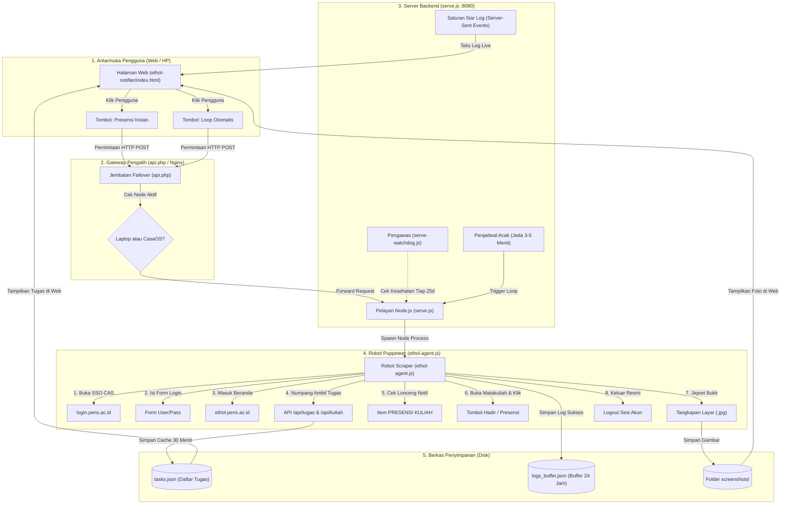

# Laporan Komprehensif: Cara Kerja Sistem Auto Absen & Pengambilan Tugas (Ethol Notifier)

> **Catatan Pembaca**: Dokumen ini disusun secara khusus bagi pembaca yang **belum memiliki latar belakang teknis di bidang *backend*** (sisi server dan pemrosesan data di balik layar). Seluruh istilah teknis dijelaskan dengan perumpamaan sederhana saat pertama kali diperkenalkan.

---

## Daftar Isi
1. [Ringkasan Singkat](#1-ringkasan-singkat)
2. [Peta Sistem](#2-peta-sistem)
   - [2.1 Tujuan Sistem](#21-tujuan-sistem)
   - [2.2 Daftar Berkas dan Folder Penting](#22-daftar-berkas-dan-folder-penting)
   - [2.3 Komponen yang Berjalan dan Hubungan Antar-Komponen](#23-komponen-yang-berjalan-dan-hubungan-antar-komponen)
   - [2.4 Bahasa, Pustaka (*Library*), dan Versi Utama](#24-bahasa-pustaka-library-dan-versi-utama)
   - [2.5 Diagram Alur Sistem (Mermaid)](#25-diagram-alur-sistem-mermaid)
3. [Alur Langkah demi Langkah](#3-alur-langkah-demi-langkah)
   - [3.1 Tombol Ditekan di Antarmuka Web](#31-tombol-ditekan-di-antarmuka-web)
   - [3.2 Menyalakan Robot Peramban (Headless Browser)](#32-menyalakan-robot-peramban-headless-browser)
   - [3.3 Masuk Akun via CAS SSO Kampus](#33-masuk-akun-via-cas-sso-kampus)
   - [3.4 Mengambil Tugas Kuliah Mendekati Tenggat (Metode Numpang / Piggyback)](#34-mengambil-tugas-kuliah-mendekati-tenggat-metode-numpang--piggyback)
   - [3.5 Pengecekan Notifikasi Jadwal Kuliah](#35-pengecekan-notifikasi-jadwal-kuliah)
   - [3.6 Mengeksekusi Presensi (Klik Tombol Hadir)](#36-mengeksekusi-presensi-klik-tombol-hadir)
   - [3.7 Mengambil Tangkapan Layar (Screenshot) Bukti](#37-mengambil-tangkapan-layar-screenshot-bukti)
   - [3.8 Keluar Resmi (Logout) & Menutup Robot](#38-keluar-resmi-logout--menutup-robot)
   - [3.9 Mekanisme Loop Otomatis dengan Jeda Acak (Randomizer)](#39-mekanisme-loop-otomatis-dengan-jeda-acak-randomizer)
   - [3.10 Pembersihan Bukti Presensi Otomatis 24 Jam](#310-pembersihan-bukti-presensi-otomatis-24-jam)
4. [Audit Aktivitas dan Keamanan](#4-audit-aktivitas-dan-keamanan)
   - [4.1 Semua Aksi Nyata ke Luar](#41-semua-aksi-nyata-ke-luar)
   - [4.2 Data yang Disimpan, Lokasi, dan Masa Retensi](#42-data-yang-disimpan-lokasi-dan-masa-retensi)
   - [4.3 Cara Kredensial dan Sesi Login Dikelola](#43-cara-kredensial-dan-sesi-login-dikelola)
   - [4.4 Penanganan Galat (*Error Handling*) dan Pencatatan Log](#44-penanganan-galat-error-handling-dan-pencatatan-log)
5. [Titik Rawan Error (Diurutkan Berdasarkan Tingkat Risiko)](#5-titik-rawan-error-diurutkan-berdasarkan-tingkat-risiko)
6. [Informasi untuk Debugging](#6-informasi-untuk-debugging)
   - [6.1 Tumpukan Teknologi (*Stack*) dan Versi](#61-tumpukan-teknologi-stack-dan-versi)
   - [6.2 Lokasi Semua Berkas Log](#62-lokasi-semua-berkas-log)
   - [6.3 Perintah Praktis untuk Memeriksa Log](#63-perintah-praktis-untuk-memeriksa-log)
   - [6.4 Daftar Berkas yang Wajib Dikirim saat Meminta Bantuan Analisis](#64-daftar-berkas-yang-wajib-dikirim-saat-meminta-bantuan-analisis)
7. [Rencana Fitur Laporan Aktivitas (Konsep Perancangan)](#7-rencana-fitur-laporan-aktivitas-konsep-perancangan)
8. [Hal yang Tidak Dapat Dipastikan dari Kode](#8-hal-yang-tidak-dapat-dipastikan-dari-kode)

---

## 1. Ringkasan Singkat
Sistem ini adalah asisten otomatisasi presensi kuliah dan pemantau tenggat tugas untuk portal akademik **ETHOL PENS**. Sistem bekerja layaknya seorang mahasiswa yang membuka peramban web (*browser*), memasukkan identitas login kampus, memeriksa lonceng pemberitahuan, mengklik tombol presensi yang aktif, mengambil foto bukti layar (*screenshot*), dan mengumpulkan daftar tugas yang mendekati batas waktu pengumpulan. Seluruh proses ini dapat dipicu sekali saja secara instan atau berjalan mandiri tanpa henti di latar belakang server (*background loop*) dengan interval acak 3 hingga 5 menit agar menyerupai ritme aktivitas manusia. Komponen utamanya terdiri dari antarmuka visual web (*frontend*), jembatan penghubung cerdas (*gateway/proxy*), pelayan latar belakang (*Node.js server daemon*), dan robot peramban tanpa jendela (*Puppeteer headless browser*).

---

## 2. Peta Sistem

### 2.1 Tujuan Sistem
Tujuan utama sistem ini adalah menghilangkan risiko mahasiswa lupa melakukan absensi saat jam kuliah berlangsung serta membantu mahasiswa memprioritaskan tugas-tugas kuliah yang tenggat waktunya kurang dari atau sama dengan 5 hari ke depan, tanpa perlu terus-menerus membuka portal kampus secara manual.

### 2.2 Daftar Berkas dan Folder Penting
Berikut adalah daftar berkas dan folder inti pada sistem auto absen beserta fungsinya masing-masing:
- [ethol-notifier/index.html](file:///c:/Users/Raden/OneDrive/Documents/New%20folder%20(2)/ethol-notifier/index.html): Halaman antarmuka pengguna berbasis web (*frontend*) tempat mahasiswa melihat status operasional, menekan tombol aksi, melihat linimasa absensi, memeriksa tugas, dan melihat bukti foto layar.
- [ethol-notifier/ethol.css](file:///c:/Users/Raden/OneDrive/Documents/New%20folder%20(2)/ethol-notifier/ethol.css): Berkas tata gaya (*styling*) visual berstandar modern yang mengatur warna, animasi partikel, kartu data, dan responsivitas layar ponsel (*mobile-first*).
- [ethol-notifier/ethol.js](file:///c:/Users/Raden/OneDrive/Documents/New%20folder%20(2)/ethol-notifier/ethol.js): Skrip pengendali tampilan web yang mengirim perintah tombol, menampilkan hitung mundur waktu, menerima siaran teks log secara langsung (*live streaming*), dan menampilkan modal foto bukti presensi.
- [serve.js](file:///c:/Users/Raden/OneDrive/Documents/New%20folder%20(2)/serve.js): Pelayan utama (*backend server daemon*) berbasis Node.js yang bertugas mengatur antrean eksekusi robot, menyediakan alamat jalur data (*API endpoints*), menyiarkan log, dan mengatur jadwal putaran otomatis.
- [serve-watchdog.js](file:///c:/Users/Raden/OneDrive/Documents/New%20folder%20(2)/serve-watchdog.js): Program pengawas mandiri (*watchdog supervisor*) yang bertugas mengecek kesehatan `serve.js` setiap 25 detik dan merestart server secara otomatis jika terjadi kemacetan (*hang* atau *crash*).
- [ethol-notifier/ethol-agent.js](file:///c:/Users/Raden/OneDrive/Documents/New%20folder%20(2)/ethol-notifier/ethol-agent.js): Program inti robot automasi (*scraper*) yang mengendalikan Google Chrome tanpa jendela (*headless browser*) untuk masuk ke akun kampus, menekan tombol presensi, dan memotret layar.
- [ethol-notifier/api.php](file:///c:/Users/Raden/OneDrive/Documents/New%20folder%20(2)/ethol-notifier/api.php): Jembatan perantara cerdas (*smart proxy gateway*) di server Nginx yang mampu mengalihkan permintaan data secara otomatis ke laptop atau ke server lokal CasaOS.
- [ethol-notifier/ethol-config.json](file:///c:/Users/Raden/OneDrive/Documents/New%20folder%20(2)/ethol-notifier/ethol-config.json): Berkas konfigurasi rahasia di komputer lokal yang menyimpan identitas surat elektronik (*email*) kampus dan kata sandi login mahasiswa.
- [ethol-notifier/tasks.json](file:///c:/Users/Raden/OneDrive/Documents/New%20folder%20(2)/ethol-notifier/tasks.json): Berkas penampung sementara (*cache*) format JSON yang menyimpan daftar tugas aktif yang belum dikumpulkan beserta tanggal tenggat waktunya.
- [logs_buffer.json](file:///c:/Users/Raden/OneDrive/Documents/New%20folder%20(2)/logs_buffer.json): Berkas penyimpan catatan riwayat teks presensi yang sukses dalam jangka waktu 24 jam terakhir agar data tidak hilang ketika server dimatikan.
- [ethol-notifier/screenshots/](file:///c:/Users/Raden/OneDrive/Documents/New%20folder%20(2)/ethol-notifier/screenshots): Folder tempat penyimpanan berkas gambar (*JPEG*) hasil pemotretan layar bukti presensi dan bukti diagnostik saat terjadi galat.
- [docker-compose.yml](file:///c:/Users/Raden/OneDrive/Documents/New%20folder%20(2)/docker-compose.yml): Berkas pengaturan wadah aplikasi (*Docker container*) agar sistem backend dapat berjalan secara mandiri dan terisolasi di server CasaOS.
- [deploy.ps1](file:///c:/Users/Raden/OneDrive/Documents/New%20folder%20(2)/deploy.ps1): Skrip otomatisasi PowerShell untuk menyalin berkas pembaruan web dari komputer lokal ke Home Server Nginx publik.

### 2.3 Komponen yang Berjalan dan Hubungan Antar-Komponen
Sistem ini terbagi menjadi empat lapisan komponen yang saling berbicara satu sama lain:

1. **Halaman Antarmuka (*Frontend Client*)**: Berjalan di peramban web pengguna (baik di laptop maupun di ponsel Android). Komponen ini tidak pernah mengakses akun kampus secara langsung, melainkan hanya menampilkan tombol dan meminta data kepada server backend melalui protokol HTTP/HTTPS.
2. **Jembatan Proxy Mandiri (*api.php / Gateway*)**: Berada di server web Nginx. Ketika halaman web dibuka dari jaringan publik atau ponsel, permintaan dikirim ke `api.php`. Jembatan ini memiliki logika *failover* (pengalihan otomatis): jika laptop pengguna menyala dan aktif terhubung lewat Tailscale VPN, permintaan diteruskan ke laptop; jika tidak, permintaan dialihkan ke server CasaOS.
3. **Pelayan Latar Belakang (*Backend Daemon - serve.js*)**: Berjalan di porta (*port*) 8080. Komponen ini menerima perintah tombol seperti `run` (jalankan presensi instan), `loop/start` (mulai siklus otomatis), atau `tugas` (minta daftar tugas). Server ini juga menjaga agar robot scraper hanya berjalan satu per satu (tidak tumpang tindih) melalui penanda status (*mutex flag*) `agentRunning`.
4. **Robot Pekerja (*Scraper Worker - ethol-agent.js*)**: Dijalankan oleh `serve.js` sebagai proses anak (*child process*). Robot ini membuka peramban Puppeteer tersembunyi, melakukan pengetikan username/password di portal kampus, mendeteksi tombol presensi, dan mengabadikan bukti tangkapan layar.

### 2.4 Bahasa, Pustaka (*Library*), dan Versi Utama
- **Node.js** (Versi Lingkungan Runtime: Node.js LTS v18/v20+): Bahasa utama pemrosesan logika backend di komputer laptop dan server. Menggunakan sistem modul bawaan *CommonJS*.
- **Puppeteer** (Versi `^25.10.0` pada [package.json](file:///c:/Users/Raden/OneDrive/Documents/New%20folder%20(2)/package.json) dan image Docker `puppeteer/puppeteer:22`): Pustaka resmi pengendali peramban Chromium secara otomatis melalui kode.
- **PHP** (Versi 7.4 / 8.x pada lingkungan server web Nginx CasaOS): Digunakan khusus pada berkas [ethol-notifier/api.php](file:///c:/Users/Raden/OneDrive/Documents/New%20folder%20(2)/ethol-notifier/api.php) untuk fungsi perutean (*routing*) dan proxy ringan.
- **HTML5, Vanilla CSS, dan Vanilla JavaScript (ES6+)**: Teknologi antarmuka web murni tanpa kerangka kerja (*framework*) berat eksternal, menjamin kecepatan muat instan pada koneksi internet seluler.

### 2.5 Diagram Alur Sistem (Mermaid)



---

## 3. Alur Langkah demi Langkah

Bagian ini membedah kronologi teknis sejak pengguna menekan tombol hingga hasil tampil di layar secara tuntas:

### 3.1 Tombol Ditekan di Antarmuka Web
- **Aksi Sistem**: Pengguna menekan tombol **"Presensi Instan"** (atau pintasan *shortcut* keyboard `Ctrl+R`), atau tombol **"Mulai Loop Otomatis"**.
- **Berkas & Fungsi**: Berkas [ethol-notifier/ethol.js](file:///c:/Users/Raden/OneDrive/Documents/New%20folder%20(2)/ethol-notifier/ethol.js), fungsi `triggerInstantPresensi()` atau `toggleAutoLoop()`.
- **Jalur Permintaan (*Request*)**:
  - Untuk presensi instan: mengirim HTTP `POST` ke `/api/absen/run` (membawa opsi `{ force: false }`).
  - Untuk loop otomatis: mengirim HTTP `POST` ke `/api/absen/loop/start`.
- **Penanganan Balasan (*Response*)**: Server merespons format JSON `{ ok: true, msg: "Agent dimulai." }` dengan kode status `200 OK`. Jika sedang ada robot lain yang berjalan, server membalas kode `409 Conflict` bertuliskan `"Agent sedang berjalan."`, sehingga tombol di web beralih ke animasi berputar (*loading spinner*) dan sementara dinonaktifkan (*disabled*) guna mencegah klik ganda.

### 3.2 Menyalakan Robot Peramban (*Headless Browser*)
- **Aksi Sistem**: Server [serve.js](file:///c:/Users/Raden/OneDrive/Documents/New%20folder%20(2)/serve.js) mengeksekusi perintah sistem `spawn('node', ['ethol-agent.js'])`.
- **Penghematan Beban Komputer**: Robot mengaktifkan fitur pencegatan permintaan (*Request Interception*). Berkas-berkas berbobot berat seperti *font* tipografi dan berkas *media/video* diblokir secara terprogram (`req.abort()`). Hal ini memangkas konsumsi memori RAM server hingga lebih dari 60% dan mempercepat waktu muat halaman.
- **Profil Peramban**: Menggunakan folder penyimpanan data pengguna terisolasi [ethol-notifier/.puppeteer_profile](file:///c:/Users/Raden/OneDrive/Documents/New%20folder%20(2)/ethol-notifier/.puppeteer_profile) agar *cache* peramban tersimpan rapi dan tidak mengotori sistem operasi utama.

### 3.3 Masuk Akun via CAS SSO Kampus
- **Aksi Sistem**: Robot membuka gerbang pintu masuk tunggal (*Central Authentication Service / Single Sign-On*) kampus PENS.
- **Berkas & Alamat Target**: 
  - Fungsi `runAutoAbsen()` di [ethol-notifier/ethol-agent.js](file:///c:/Users/Raden/OneDrive/Documents/New%20folder%20(2)/ethol-notifier/ethol-agent.js).
  - Alamat Permintaan: `GET https://login.pens.ac.id/cas/login?service=https%3A%2F%2Fethol.pens.ac.id%2Fapi%2Fauth%2Fcas-callback`.
- **Pengisian Data Formulir**: Robot menunggu elemen input formulir `#username` dan `#password` muncul, lalu memasukkan email mahasiswa dan kata sandi yang dibaca dari [ethol-notifier/ethol-config.json](file:///c:/Users/Raden/OneDrive/Documents/New%20folder%20(2)/ethol-notifier/ethol-config.json) atau variabel lingkungan (*Environment Variable*). Robot memicu event `input` dan `change` agar mesin antarmuka kampus memvalidasi bahwa kolom telah terisi.
- **Pengiriman Formulir**: Robot mengklik elemen tombol `input[name="submit"]` (metode `POST` dari formulir peramban).
- **Data yang Dibaca**: URL hasil pengalihan (*redirect*). Jika login sukses, alamat peramban berubah menjadi `https://ethol.pens.ac.id/...`.
- **Jika Terjadi Kegagalan**: Jika halaman tetap berada di `login.pens.ac.id`, robot mendeteksi pesan kesalahan pada elemen kelas `.errors`, `.error`, atau `#msg` (misalnya: *"Kredensial tidak valid"*), mencatat galat ke log, memotret layar galat, dan menghentikan proses (*exit*).

### 3.4 Mengambil Tugas Kuliah Mendekati Tenggat (Metode Numpang / Piggyback)
- **Aksi Sistem**: Memanfaatkan sesi login yang masih hangat dan aktif di portal Ethol untuk sekaligus mengumpulkan daftar tugas kuliah tanpa perlu membuat sesi login terpisah.
- **Berkas & Fungsi**: Fungsi `checkTugasKuliah()` di [ethol-notifier/ethol-agent.js](file:///c:/Users/Raden/OneDrive/Documents/New%20folder%20(2)/ethol-notifier/ethol-agent.js).
- **Jeda Pengecekan (*Throttling*)**: Agar tidak membebani server kampus (*spam request*), pengecekan tugas dibatasi hanya terjadi satu kali setiap **30 menit**. Jika belum 30 menit sejak pengecekan terakhir, langkah ini langsung dilewati (*skipped*) dan sistem menggunakan data dari berkas [ethol-notifier/tasks.json](file:///c:/Users/Raden/OneDrive/Documents/New%20folder%20(2)/ethol-notifier/tasks.json).
- **Permintaan HTTP Internal Ethol**:
  1. `GET /api/kuliah?tahun=2026&semester=1` (mengambil daftar mata kuliah yang sedang ditempuh mahasiswa pada semester berjalan).
  2. Untuk setiap mata kuliah yang ditemukan: `GET /api/tugas?kuliah={nomor}&jenisSchema={jenisSchema}`.
- **Penyaringan (*Filter*) Logika Tugas**:
  - **Syarat 1 (Belum Selesai)**: Hanya mengambil data tugas yang nilai berkas pengumpulannya kosong (`!t.submission_file` atau `isSubmitted === false`).
  - **Syarat 2 (Tenggat Mendesak)**: Menghitung selisih waktu antara detik ini dengan waktu tenggat (`deadline`). Hanya meloloskan tugas dengan sisa waktu dalam rentang **≤ 5 hari ke depan**.
- **Penyimpanan**: Hasil tugas yang lolos disaring diurutkan dari yang paling mendesak (H-1, H-2, dst.) dan ditulis ke berkas [ethol-notifier/tasks.json](file:///c:/Users/Raden/OneDrive/Documents/New%20folder%20(2)/ethol-notifier/tasks.json).
- **Jika Gagal**: Kesalahan ditangkap dalam blok `try...catch`, dicatat ke log sebagai peringatan (*warning*), dan proses presensi kuliah utama tetap dilanjutkan tanpa terganggu.

### 3.5 Pengecekan Notifikasi Jadwal Kuliah
- **Aksi Sistem**: Robot berpindah ke halaman utama mahasiswa (`https://ethol.pens.ac.id/mahasiswa/beranda`) dan mencari ikon lonceng pemberitahuan (*notification bell*).
- **Pencarian Elemen Fleksibel (*Semantic Selectors*)**: Robot memeriksa daftar tanda pengenal elemen lonceng seperti `button[aria-label="Notifikasi"]`, `button[class*="notif"]`, maupun elemen ikon dengan kelas `fa-bell`.
- **Membaca Isi Panel Lonceng**: Robot membaca wadah daftar notifikasi (`[class*="_notifList_"]`) dan memindai teks setiap item. Robot secara spesifik menyaring item yang mengandung frasa teks kapital: `"PRESENSI KULIAH"`.
- **Penyaringan Waktu Notifikasi (*Freshness Filter*)**:
  - Item notifikasi yang memiliki keterangan lampau seperti *"3 hari yang lalu"* atau *"1 minggu yang lalu"* secara otomatis **dilewati**, karena sesi kuliah tersebut sudah kedaluwarsa.
  - Robot hanya memproses notifikasi berlabel waktu baru seperti *"beberapa detik lalu"*, *"menit"*, *"jam"*, *"baru saja"*, atau *"hari ini"*. (Pengecualian: jika dijalankan dengan parameter khusus `--force`, seluruh item akan diproses).
- **Jika Tidak Ada Notifikasi**: Robot mengeluarkan log ramah bertuliskan: *"Tidak ada sesi presensi aktif yang dibuka dosen hari ini"*, lalu langsung menuju ke proses keluar akun secara aman.

### 3.6 Mengeksekusi Presensi (Klik Tombol Hadir)
- **Aksi Sistem**: Untuk setiap notifikasi presensi yang masih berlaku (*fresh*), robot mengklik tautan notifikasi tersebut hingga peramban berpindah ke halaman mata kuliah terkait (`.../matakuliah/...`).
- **Pemeriksaan Tombol Presensi**: Robot mencari tombol yang memuat teks `"Presensi"` atau `"PRESENSI"`.
- **Pencabangan Kondisi (*Branching*)**:
  - **Kondisi A: Tombol Terkunci (*Disabled / Locked*)**: Berarti sesi presensi belum dimulai oleh dosen, atau mahasiswa sebenarnya sudah tercatat hadir sebelumnya. Robot memeriksa teks halaman (*attendance audit*). Jika ditemukan tanggal hari ini atau tanda kehadiran, status dicatat sebagai `SUKSES_TERCATAT`. Jika memang sesi ditutup, dicatat sebagai `DISABLED`.
  - **Kondisi B: Tombol Aktif (*Clickable*)**: Robot langsung mengklik tombol tersebut. Jika muncul kotak dialog konfirmasi (*popup confirmation modal*), robot mendeteksi tombol bermakna persetujuan seperti `"Ya"`, `"OK"`, `"Konfirmasi"`, atau `"Hadir"`, lalu mengkliknya.
- **Verifikasi Keberhasilan**: Robot menunggu jeda 2 detik agar sistem kampus selesai memperbarui data, lalu memeriksa apakah muncul kata kunci konfirmasi seperti `"berhasil"`, `"hadir"`, atau tanda centang hijau (`✓`).

### 3.7 Mengambil Tangkapan Layar (Screenshot) Bukti
- **Aksi Sistem**: Robot menggulirkan tampilan kembali ke puncak halaman (`window.scrollTo(0, 0)`), lalu mengambil foto layar penuh sebagai bukti visual otentik bahwa presensi telah tercatat di server kampus.
- **Penamaan Berkas**: Berkas foto disimpan dalam format JPEG berkualitas tinggi (kompresi 90%) dengan pola nama unik berbasis stempel waktu komputer:  
  `presensi_{WAKTU_MILIDETIK}_{KODE_ACAK}.jpg` (contoh nyata: `presensi_1789612302042_ojwlh.jpg`).
- **Penyebaran Berkas Multi-Jalur**: Berkas gambar ini disimpan secara otomatis ke folder lokal [ethol-notifier/screenshots/](file:///c:/Users/Raden/OneDrive/Documents/New%20folder%20(2)/ethol-notifier/screenshots) dan disinkronkan ke direktori server web Nginx agar dapat dibuka oleh pengguna melalui ponsel.

### 3.8 Keluar Resmi (Logout) & Menutup Robot
- **Aksi Sistem**: Robot menjalankan fungsi `performLogout()` di [ethol-notifier/ethol-agent.js](file:///c:/Users/Raden/OneDrive/Documents/New%20folder%20(2)/ethol-notifier/ethol-agent.js).
- **Langkah Bersih (*Anti-Zombie Teardown*)**:
  - Robot mencari tombol *"Keluar"* atau *"Logout"* di menu samping (*sidebar*) Ethol dan mengklik konfirmasi. Jika menu tidak ditemukan, robot langsung memuat alamat `https://ethol.pens.ac.id/logout`.
  - Proses logout dibatasi batas waktu maksimal 5 detik (`Promise.race`) agar robot tidak pernah macet (*stuck*) di tahap penutupan.
  - Terakhir, perintah `browser.close()` dieksekusi untuk mematikan seluruh proses peramban Chromium dari memori komputer.

### 3.9 Mekanisme Loop Otomatis dengan Jeda Acak (Randomizer)
- **Aksi Sistem**: Jika mode **"Loop Otomatis"** diaktifkan, server [serve.js](file:///c:/Users/Raden/OneDrive/Documents/New%20folder%20(2)/serve.js) tidak langsung menjalankan putaran berikutnya secara kaku pada interval detik yang sama persis.
- **Logika Acak (*Humanized Interval*)**: Fungsi `getRandomIntervalSec(180, 300)` menghitung angka acak antara 180 detik (3 menit) hingga 300 detik (5 menit).
- **Tujuan**: Mencegah pola akses berkala berulang yang dapat dicurigai sebagai serangan robot (*bot detection*) oleh sistem keamanan kampus.
- **Ketahanan Latar Belakang**: Siklus loop ini hidup di sisi server Node.js. Artinya, meskipun pengguna menutup peramban di laptop atau mematikan layar ponsel, putaran presensi otomatis akan tetap berjalan sesuai jadwal di server.

### 3.10 Pembersihan Bukti Presensi Otomatis 24 Jam
- **Aksi Sistem**: Setiap kali server dijalankan atau sebelum robot presensi bekerja, sistem memanggil fungsi `cleanupExpiredScreenshots()`.
- **Mekanisme Retensi**: Sistem membaca usia berkas pada disk. Berkas gambar yang waktu pembuatannya telah melebihi batas 24 jam (`now - stat.mtimeMs > 24 * 60 * 60 * 1000`) akan dihapus secara permanen dari folder tangkapan layar.
- **Pengecualian Proteksi**: Berkas contoh bernama `presensi_sample.jpg` dilindungi secara khusus agar tidak pernah terhapus karena digunakan sebagai contoh tampilan dasar di antarmuka web.

---

## 4. Audit Aktivitas dan Keamanan

### 4.1 Semua Aksi Nyata ke Luar
Sistem ini hanya berkomunikasi ke alamat-alamat spesifik berikut:
1. **Ke Server Kampus PENS**:
   - `login.pens.ac.id`: Menerima permintaan GET untuk memuat formulir autentikasi SSO CAS dan POST untuk verifikasi kredensial.
   - `ethol.pens.ac.id`: Menerima navigasi halaman utama, permintaan pembacaan notifikasi, permintaan data API mata kuliah dan tugas (`/api/kuliah`, `/api/tugas`), serta pengiriman aksi klik presensi kehadiran.
2. **Ke Penyimpanan Komputer (*Disk Drive*)**:
   - Menulis berkas gambar hasil jepretan layar di folder `screenshots/`.
   - Menulis berkas catatan buffer log [logs_buffer.json](file:///c:/Users/Raden/OneDrive/Documents/New%20folder%20(2)/logs_buffer.json) dan ringkasan tugas [ethol-notifier/tasks.json](file:///c:/Users/Raden/OneDrive/Documents/New%20folder%20(2)/ethol-notifier/tasks.json).
   - Menulis data profil sementara di `.puppeteer_profile/`.
3. **Ke Server Nginx / Telemetri Internal**:
   - Mengirim laporan denyut nadi status (*Heartbeat telemetry*) melalui POST ke `https://dashboard.raidenarya.my.id/ethol-notifier/api.php?path=heartbeat` setiap beberapa detik agar dashboard mengetahui bahwa laptop/server dalam kondisi menyala (*online*).

### 4.2 Data yang Disimpan, Lokasi, dan Masa Retensi

| Jenis Data | Format & Nama Berkas | Lokasi Penyimpanan | Masa Retensi (Masa Simpan) |
| :--- | :--- | :--- | :--- |
| **Kredensial Akun** | JSON (`ethol-config.json`) | Folder lokal `ethol-notifier/` | Permanen (dikelola mandiri oleh pengguna di komputer lokal) |
| **Tangkapan Layar Bukti** | Berkas gambar `.jpg` | `ethol-notifier/screenshots/` | **Maksimal 24 Jam** (dihapus otomatis oleh fungsi `cleanupExpiredScreenshots`) |
| **Buffer Log Presensi** | JSON (`logs_buffer.json`) | Folder root & `ethol-notifier/` | **Maksimal 24 Jam** (disaring oleh stempel waktu `now - ts < 86400000`) |
| **Daftar Tugas Kuliah** | JSON (`tasks.json`) | `ethol-notifier/tasks.json` | Diperbarui berkala dengan masa berlaku *cache* **30 menit** |
| **Sesi Profil Peramban** | Cookies & Cache Chromium | `ethol-notifier/.puppeteer_profile/` | Bergantung pada masa berlaku sesi CAS PENS |

### 4.3 Cara Kredensial dan Sesi Login Dikelola
- **Prinsip Keamanan Berkas Lokal (*Zero Leakage*)**: Nama pengguna (*email*) dan kata sandi akun tidak pernah dimasukkan ke dalam kode program yang diunggah ke internet (*hardcoded*). Kredensial disimpan pada berkas lokal `ethol-config.json` yang secara mutlak diabaikan dari pencatatan Git melalui pengaturan [.gitignore](file:///c:/Users/Raden/OneDrive/Documents/New%20folder%20(2)/.gitignore) dan dilindungi oleh skrip [deploy.ps1](file:///c:/Users/Raden/OneDrive/Documents/New%20folder%20(2)/deploy.ps1) agar tidak pernah tersalin ke server publik.
- **Penyensoran di Layar & Log**: Pada saat robot mengisi kata sandi, keluaran teks konsol menyamarkan karakter sandi menjadi tanda bintang penuh (`****`). Pada tampilan web antarmuka, disediakan tombol sakelar mata (*Eye Toggle*) untuk menyamarkan identitas nama dan email mahasiswa saat dashboard dibuka di tempat umum.
- **Siklus Hidup Sesi (*Session Lifecycle*)**: Sesi login tidak dibiarkan menggantung. Di akhir setiap putaran automasi presensi, robot selalu menjalankan prosedur logout resmi ke portal kampus, lalu menutup peramban Chromium secara tuntas untuk mencegah pencurian sesi (*session hijacking*).

### 4.4 Penanganan Galat (*Error Handling*) dan Pencatatan Log
- **Penjaga Kemacetan Global (*Crash Guards*)**: Di berkas [serve.js](file:///c:/Users/Raden/OneDrive/Documents/New%20folder%20(2)/serve.js), dipasang penangkap galat global `process.on('uncaughtException')` dan `process.on('unhandledRejection')` agar server tidak mati mendadak saat terjadi kegagalan jaringan yang tak terduga.
- **Tangkapan Layar Diagnostik Otomatis (*Visual Proof on Failure*)**: Apabila robot mengalami galat di tengah proses peramban, blok `catch` pada `ethol-agent.js` secara otomatis memotret layar saat itu juga dengan nama berkas berawalan `error_{timestamp}.jpg`. Ini memudahkan pengembang melihat kondisi visual layar portal kampus saat terjadi masalah.
- **Siaran Log Waktu-Nyata (*Server-Sent Events / SSE*)**: Setiap baris log yang dihasilkan oleh robot dialirkan secara langsung ke panel diagnostik di peramban web pengguna tanpa perlu memuat ulang (*reload*) halaman.

---

## 5. Titik Rawan Error (Diurutkan Berdasarkan Tingkat Risiko)

Tabel berikut menyajikan potensi kegagalan operasional yang diurutkan dari **dampak risiko tertinggi** hingga terendah:

| Peringkat & Titik Rawan | Penyebab yang Mungkin Terjadi | Gejala yang Terlihat di Antarmuka | Cara Memeriksa & Solusi |
| :--- | :--- | :--- | :--- |
| **1. Perubahan Struktur HTML Portal ETHOL PENS** *(Risiko Kritis)* | Tim pengembang web kampus memperbarui desain atau mengganti nama kelas CSS/elemen (misal tombol lonceng atau teks `"PRESENSI KULIAH"` diubah). | Robot berhasil login, namun muncul pesan *"Panel notifikasi kosong atau selector berubah"* atau *"Tombol Presensi tidak ditemukan"*. | Buka peramban biasa, tekan F12 (*Inspect Element*), periksa apakah nama tombol dan struktur notifikasi di Ethol mengalami perubahan. |
| **2. Mekanisme Keamanan Baru di SSO CAS PENS (Captcha / 2FA / Blokir IP)** *(Risiko Kritis)* | Kampus memasang verifikasi gambar (*Captcha*), autentikasi dua langkah ke HP (*Two-Factor Auth*), atau membatasi jumlah login per menit dari satu alamat IP. | Proses terhenti di Langkah 3 atau Langkah 4. Log mencatat pesan galat *"Login CAS gagal"* atau navigasi waktu habis (*timeout*). | Periksa berkas tangkapan layar `error_*.jpg` di folder `screenshots/`. Jika ada gambar captcha atau halaman blokir, sistem otomatisasi berbasis skrip tidak dapat menembusnya tanpa solusi penanganan captcha. |
| **3. Kata Sandi Kampus Diganti / Kedaluwarsa** *(Risiko Tinggi)* | Mahasiswa memperbarui kata sandi akun email PENS berkala, namun lupa memperbarui berkas konfigurasi lokal. | Log mencatat galat *"Login CAS gagal: Kredensial tidak valid"* secara berulang-ulang setiap putaran. | Buka berkas lokal [ethol-notifier/ethol-config.json](file:///c:/Users/Raden/OneDrive/Documents/New%20folder%20(2)/ethol-notifier/ethol-config.json) dan sesuaikan kata sandi baru yang sah. |
| **4. Server Kampus *Down* / Terlalu Lambat (*Timeout*)** *(Risiko Menengah-Tinggi)* | Server kampus mengalami kelebihan beban pada jam-jam sibuk perkuliahan (pukul 07.30 - 08.30 pagi). | Log mencatat pesan galat peramban: `TimeoutError: Navigation timeout of 60000 ms exceeded`. | Cek apakah alamat `ethol.pens.ac.id` dapat dibuka melalui peramban ponsel secara manual. Jika memang down, sistem loop otomatis akan mencoba lagi pada putaran berikutnya. |
| **5. Pelayan Node.js Mati atau Macet di Latar Belakang** *(Risiko Menengah)* | Pengguna tidak sengaja menutup jendela terminal, laptop beralih ke mode tidur (*Sleep/Hibernate*), atau kehabisan memori. | Panel web menampilkan status *"Server Tidak Terjangkau"*, tombol presensi macet dalam kondisi loading, indikator gateway merah. | Periksa apakah proses `node serve.js` atau [serve-watchdog.js](file:///c:/Users/Raden/OneDrive/Documents/New%20folder%20(2)/serve-watchdog.js) masih berjalan di pengelola tugas (*Task Manager* Windows / Docker CasaOS). |
| **6. Folder Screenshots Penuh pada Penyimpanan Kecil** *(Risiko Rendah-Menengah)* | Fitur pembersihan berkas 24 jam gagal berjalan karena pembatasan hak akses (*permission denied*) pada folder disk. | Ruang penyimpanan server menipis; log mencatat kegagalan fungsi `fs.unlinkSync()`. | Periksa hak akses tulis folder `screenshots/` dan pastikan fungsi `cleanupExpiredScreenshots` aktif. |

---

## 6. Informasi untuk Debugging

### 6.1 Tumpukan Teknologi (*Stack*) dan Versi
- **Node.js**: Versi LTS 18.x atau 20.x.
- **Puppeteer**: Versi `25.10.0`.
- **Sistem Operasi**: Windows 11 (Lingkungan Pengembangan Laptop) & Linux Alpine/Ubuntu Docker (Lingkungan Server CasaOS).
- **Web Server Proxy**: Nginx 1.2x & PHP 7.4/8.x (pada Home Server `100.73.128.8`).

### 6.2 Lokasi Semua Berkas Log
1. **Log Operasional Presensi Sukses (JSON)**:  
   Tersimpan pada [logs_buffer.json](file:///c:/Users/Raden/OneDrive/Documents/New%20folder%20(2)/logs_buffer.json) dan [ethol-notifier/logs_buffer.json](file:///c:/Users/Raden/OneDrive/Documents/New%20folder%20(2)/ethol-notifier/logs_buffer.json).
2. **Log Konsol Server Node.js**:  
   Dicetak langsung ke jendela terminal konsol tempat perintah `node serve.js` atau `serve-watchdog.js` dijalankan.
3. **Log Panel Diagnostik Web**:  
   Dapat dilihat langsung pada antarmuka web [ethol-notifier/index.html](file:///c:/Users/Raden/OneDrive/Documents/New%20folder%20(2)/ethol-notifier/index.html) di bagian panel **"Log Diagnostik"** (memiliki tombol *Salin Log* dan tab pemisah *Presensi / Loop Engine*).
4. **Log Web Server Nginx (CasaOS)**:  
   Tersimpan di server pada alamat `/DATA/AppData/nginx/logs/error.log` dan `/DATA/AppData/nginx/logs/access.log`.

### 6.3 Perintah Praktis untuk Memeriksa Log
Jalankan perintah-perintah berikut melalui jendela terminal PowerShell di komputer lokal:

- **Memeriksa respon kesehatan server lokal (Health Check)**:
  ```powershell
  curl http://127.0.0.1:8080/api/absen/health
  ```
- **Memeriksa status terkini robot dan daftar tugas**:
  ```powershell
  curl http://127.0.0.1:8080/api/absen/status
  ```
- **Melihat isi catatan presensi 24 jam terakhir**:
  ```powershell
  Get-Content .\logs_buffer.json
  ```
- **Melihat daftar tugas aktif yang berhasil dikumpulkan**:
  ```powershell
  Get-Content .\ethol-notifier\tasks.json
  ```
- **Menjalankan pengujian presensi tiruan (Simulasi Uji Visual)**:
  ```powershell
  Invoke-RestMethod -Uri "http://127.0.0.1:8080/api/absen/test-presensi" -Method POST
  ```

### 6.4 Daftar Berkas yang Wajib Dikirim saat Meminta Bantuan Analisis
Jika sistem mengalami kendala operasional dan Anda hendak berkonsultasi kepada teknisi/pengembang, **kirimkan berkas-berkas berikut**:
1. Berkas tangkapan layar galat terbaru: `ethol-notifier/screenshots/error_*.jpg` (sangat krusial untuk melihat kondisi antarmuka kampus saat gagal).
2. Salinan teks dari panel **Log Diagnostik** di halaman web (gunakan tombol *"Salin Log"*).
3. Berkas konfigurasi [ethol-notifier/tasks.json](file:///c:/Users/Raden/OneDrive/Documents/New%20folder%20(2)/ethol-notifier/tasks.json) dan [logs_buffer.json](file:///c:/Users/Raden/OneDrive/Documents/New%20folder%20(2)/logs_buffer.json).
4. Berkas catatan status node di server: `device_state.json` dan `node_health.json` (jika ada).
> [!CAUTION]
> **PERINGATAN KEAMANAN**: **JANGAN PERNAH** melampirkan atau mengirimkan berkas `ethol-config.json` karena berkas tersebut memuat kata sandi pribadi Anda!

---

## 7. Rencana Fitur Laporan Aktivitas (Konsep Perancangan)

> **Catatan Penting**: Bab ini **HANYA RENCANA KONSEPTUAL** sebagai acuan pengembangan di masa mendatang. Rencana ini belum diterapkan pada kode saat ini.

### 7.1 Tujuan Fitur
Menyediakan tabel riwayat komprehensif di antarmuka web yang mencatat setiap kali sistem selesai berputar, baik saat ada mata kuliah yang berhasil diabsen, saat tidak ada jadwal kuliah, maupun saat terjadi kendala jaringan, tanpa mengekspos informasi pribadi atau rahasia.

### 7.2 Struktur Data yang Direncanakan
Setiap sesi eksekusi akan dicatat sebagai objek riwayat ringan:
```json
{
  "id": "act_1789612300",
  "waktu": "2026-10-02T08:30:00+07:00",
  "mode": "loop", // atau "instant"
  "langkah_terakhir": "Pengecekan Notifikasi",
  "status": "DILEWATI", // "SUKSES" | "DILEWATI" | "GAGAL"
  "mata_kuliah": "Workshop Pemrograman Lanjut",
  "durasi_detik": 14.2,
  "pesan": "Tidak ada sesi presensi aktif yang dibuka dosen.",
  "bukti_gambar": null
}
```

### 7.3 Tempat Penyimpanan & Batas Retensi
- **Tempat Penyimpanan**: Berkas JSON terpisah bernama `ethol-notifier/activity_history.json` yang dikelola langsung oleh `serve.js`.
- **Batas Retensi (*Retention Policy*)**:
  - Dibatasi maksimal **100 baris entri terakhir** (menggunakan antrean *First-In First-Out* / data terlama otomatis dibuang jika melebihi batas).
  - Data yang berumur lebih dari **3 hari (72 jam)** otomatis dibersihkan setiap kali berkas disimpan, menjaga ukuran berkas tetap di bawah 100 KB.

### 7.4 Rencana Tampilan di Antarmuka Halaman Web
- Ditambahkan kartu lipat baru bertajuk **"Laporan Aktivitas Sistem"** di bawah linimasa presensi pada [ethol-notifier/index.html](file:///c:/Users/Raden/OneDrive/Documents/New%20folder%20(2)/ethol-notifier/index.html).
- Menampilkan tabel responsif dengan badge status warna:
  - Hijau: **Berhasil Absen**
  - Abu-abu/Biru: **Dilewati (Tidak Ada Jadwal / Selesai)**
  - Merah: **Gagal / Gangguan Jaringan**
- Dilengkapi ringkasan metrik statistik sederhana: *Total Putaran Hari Ini*, *Tingkat Keberhasilan (%)*, dan *Rata-Rata Waktu Eksekusi*.

### 7.5 Titik Kode yang Perlu Disentuh saat Implementasi Kelak
1. Di [serve.js](file:///c:/Users/Raden/OneDrive/Documents/New%20folder%20(2)/serve.js):
   - Tambahkan fungsi pembaca dan penyimpan `activity_history.json`.
   - Buat endpoint baru `GET /api/absen/activities`.
   - Pada penanganan `proc.on('close')`, hitung durasi eksekusi (`Date.now() - startTime`) dan catat objek ringkasan ke dalam riwayat.
2. Di [ethol-notifier/ethol.js](file:///c:/Users/Raden/OneDrive/Documents/New%20folder%20(2)/ethol-notifier/ethol.js):
   - Tambahkan fungsi `loadActivityHistory()` untuk mengambil data via `GatewayManager.fetchJson('activities')`.
   - Bangun fungsi *rendering* tabel di DOM antarmuka pengguna.

---

## 8. Hal yang Tidak Dapat Dipastikan dari Kode

Sebagai wujud kejujuran teknis, berikut adalah daftar hal-hal penting yang **tidak dapat dipastikan secara 100% hanya melalui pembacaan kode statis**, dan memerlukan pengujian operasional nyata (*live execution*) dengan akun aktif untuk diverifikasi:

1. **Format Tepat Pesan Kesalahan pada CAS Kampus**:  
   Kode mencari pesan kegagalan login pada selektor `.errors, .error, #msg, .alert`. Apakah portal CAS PENS saat ini masih menggunakan tanda pengenal elemen tersebut atau telah berubah, tidak dapat dipastikan tanpa mencoba login dengan kata sandi yang salah secara langsung.
2. **Kondisi Khusus jika Mahasiswa Memiliki Lebih dari 1 Sesi Kuliah Bersamaan**:  
   Kode memiliki mekanisme perulangan (*looping*) untuk memproses seluruh item berlabel `"PRESENSI KULIAH"`. Namun, apakah router aplikasi Ethol selalu mulus kembali ke halaman beranda dan membuka kembali panel lonceng saat memproses 2 atau 3 notifikasi berturut-turut, hanya dapat dipastikan ketika terjadi jadwal kuliah ganda di lapangan.
3. **Perubahan Format Respon API `/api/kuliah` dan `/api/tugas` Kampus**:  
   Kode mengasumsikan parameter semester `tahun=2026&semester=1` dan mengharapkan kolom properti bernama `nomor`, `jenisSchema`, serta `submission_file`. Jika struktur JSON dari server kampus berubah nama atau format penanggalannya berganti, fitur pengingat tugas akan menghasilkan daftar kosong.
4. **Perilaku Sesi CAS saat Terjadi Pembatasan Akses (*Rate Limiting*)**:  
   Tidak dapat dipastikan dari kode apakah server `login.pens.ac.id` menerapkan pemblokiran IP sementara jika mode loop otomatis diaktifkan terus-menerus selama berhari-hari.
5. **Ketersediaan Alamat IP Internal CasaOS (`172.20.0.1` / `100.73.128.8`)**:  
   Berkas `api.php` memiliki daftar kandidat alamat IP jaringan internal server CasaOS. Apakah alamat jembatan Docker tersebut selalu dapat dijangkau oleh container Nginx, bergantung pada konfigurasi perutean jaringan fisik yang sedang berjalan.
